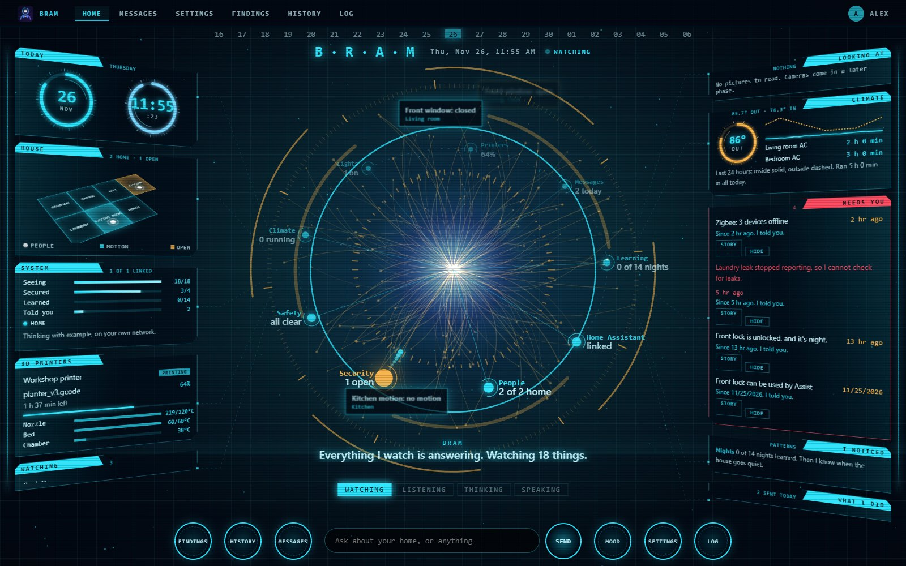
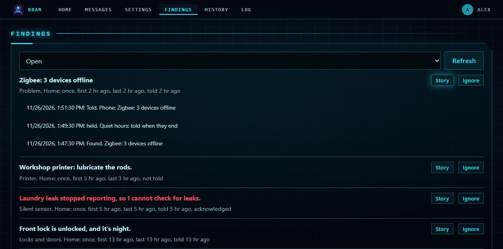
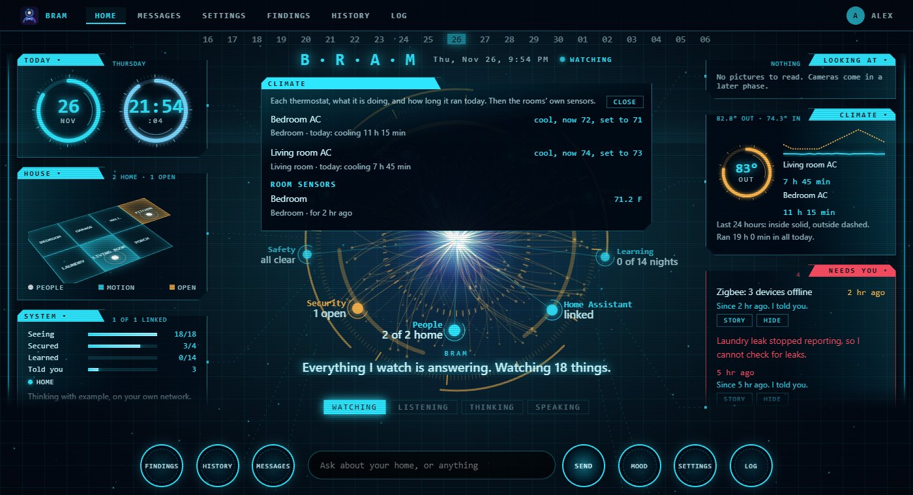
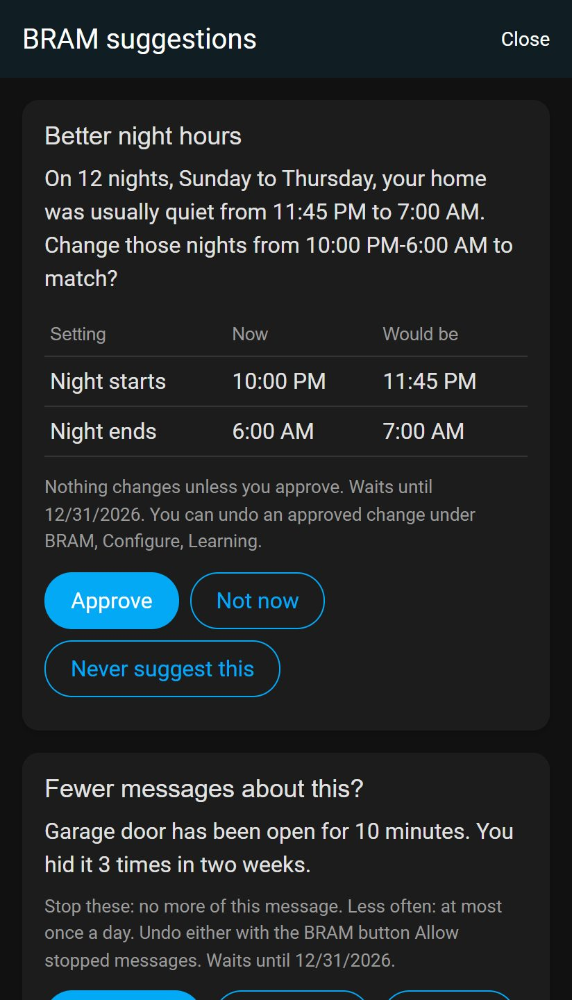

<p align="center">
  
</p>

<h1 align="center">BRAM</h1>
<p align="center"><b>Butler, Reconnaissance &amp; Automation Manager</b><br>
A self-hosted agent for your home that reaches out, instead of waiting to be asked.</p>

<p align="center">
<a href="https://github.com/imCharlieB/Bram/releases/latest"></a>
<a href="https://github.com/imCharlieB/Bram/actions/workflows/ci.yml"></a>
<a href="https://github.com/imCharlieB/Bram/blob/main/LICENSE"></a>
</p>

BRAM watches the devices you choose, tells your phone when something matters, remembers what happened, and talks with you using your own model. It finds problems by itself, without being asked. It runs on your own network, and no cloud is required.



> **Early development.** BRAM watches, tells, and talks. **It cannot control anything yet**, and it does not replace certified smoke, CO, or security alarms.

[What it does](#what-it-does) · [What you need](#what-you-need) · [Install](#install) · [First days](#first-days) · [Status](#status) · [Update](#update) · [Problems](#problems) · [Documentation](#documentation)

## What it does

| | |
|---|---|
| **Safety alerts** | Leak, smoke, CO, gas, and heat. Repeats until someone acknowledges. Runs in Home Assistant, so it works with the server or model down |
| **Silent sensors** | Tells you when a safety sensor stops reporting. Unknown is never treated as safe |
| **Locks, doors, and windows** | Unlocked at night, open while away, left open, open at night, open while heating or cooling, offline |
| **Motion and comfort** | Motion while everyone is away. Too hot, too cold, near freezing, and humid, with your own limits |
| **Problems with Home Assistant** | Failed integrations, repeating errors, low batteries, offline devices, stuck sensors, broken automations, old backups |
| **3D printers** | Found by itself: progress, time left, temperatures. Told when a print finishes, fails, or pauses, or a heater is left on |
| **Security check** | New admins and tokens, failed sign-ins, locks exposed to voice assistants, public webhooks, offline cameras, and more |
| **Findings** | One list of everything it found, with the story of each |
| **History and trends** | Temperatures, and every heating and cooling run with its settings. Compares each thermostat with the room's own sensor |
| **Learning** | Suggests better night hours from BRAM's history, and fewer messages about what you keep hiding. Nothing changes until you approve |
| **Cameras** | Connects to Frigate, read only. Tells you about a person while everyone is away, at an open or unlocked door, at night, or not known to Frigate; packages; and cars that stay in your driveway, with Frigate's picture. Zones and doors for each camera |
| **Chat and voice** | On its page, in Assist, and in Telegram, answering from live state with the facts listed underneath. Hold to talk and spoken answers, with your own Whisper and Piper |
| **Personality** | Professional, friendly, dry, minimal, unhinged, or your own |
| **Blueprints** | A yes-or-no check on a schedule, and a house summary, as automations you keep in Home Assistant |
| **Outside Home Assistant** | Telegram or ntfy if Home Assistant, Ollama, Frigate, or another device goes down |

Everything that shares or stores more is off until you turn it on.

| Findings | History |
|---|---|
|  |  |
| **A closer look on Home** | **Suggestions, in Home Assistant** |
|  |  |

## What you need

| | |
|---|---|
| Home Assistant 2026.8 or later, with HACS | For this integration |
| A 64-bit Intel or AMD machine with Docker | For the **BRAM Server**. Best on a different machine, so each can report the other failing |
| The Home Assistant app on your phone | For home alerts |
| A chat model in [Ollama](https://ollama.com) | Optional. Only chat and blueprints need it; alerts never do |

## Install

BRAM has two halves. HACS installs the integration; the server runs in Docker.

1. **Start the server** with Docker. With Docker Compose, as below. In Portainer: **Stacks > Add stack > Repository**, with repository `https://github.com/imCharlieB/Bram`, reference `refs/heads/main`, and compose path `compose.yaml`. Other Docker tools: use [compose.yaml](compose.yaml) as the guide.

   ```
   git clone https://github.com/imCharlieB/Bram.git
   cd Bram
   docker compose up -d
   ```

2. **Create your login.** Open `https://SERVER:8765` right away, with **https**. The browser warns because the server makes its own certificate. Setup closes 15 minutes after the server starts; if it has closed, restart the container.
3. **Add the integration.** HACS > three dots > **Custom repositories** > add `https://github.com/imCharlieB/Bram` as an **Integration**. Download **BRAM** and restart Home Assistant.
4. **Pair them.** On BRAM's page: **Settings > Connect a Home Assistant > Get code**. In Home Assistant: **Settings > Devices & services > Add integration > BRAM**. Enter the server's address, port `8765`, and the code.
5. **Run Quick setup.** **BRAM > Configure > Quick setup**: pick your phone, put anything you do not want to share under **Leave these out**, and **Submit**. Nothing is shared until you do.
6. **Check it.** BRAM's device page says **Connected**. Press **Send test message**; it should reach your phone.

[Full install instructions](https://github.com/imCharlieB/Bram/blob/main/docs/installation.md)

## First days

**[Using BRAM day to day](https://github.com/imCharlieB/Bram/blob/main/docs/guide.md)** walks you through the rest, in order:

- Choose devices in **Configure > Devices**. Share a weather entity for the outside temperature.
- Turn on watches in **Configure > Watching**: Home Assistant and security, locks, doors, and windows, temperature and humidity, and 3D printers. Printers start switched off.
- Use the buttons on phone messages, and see what BRAM is doing on its Home page.
- Press **Start keeping history** on BRAM's History page, so it has trends and something to learn from.
- Choose a model under **Settings > Model** to chat.

## Status

| | Works today | Planned |
|---|---|---|
| **Watch and tell** | Safety alerts, silent sensors, locks, doors, windows, motion while away, temperature and humidity, phone messages with buttons, quiet hours, daily summary, Telegram, ntfy, monitors | Severity for every finding, safety acknowledge from BRAM's page |
| **Find problems** | Home Assistant health, 3D printers, the security check | Power and energy, network devices, poor air, appliances left on |
| **Remember** | Findings with their stories, history and trends, heating and cooling runs, prints | Memory of you and your corrections |
| **Learn** | Suggested night hours and left-open time, approved on a review page | Usual routines, suggested rules and automations |
| **Talk** | Chat on its page, in Assist, and in Telegram; voice; personalities; blueprints | Other model providers, speakers in rooms |
| **Explain** | | Likely causes and what to do |
| **Control and fix** | Nothing. BRAM cannot control anything | Lights, one-tap repairs, then locks with your approval |
| **Cameras and people** | Frigate events, camera messages with pictures, zones and doors for each camera, descriptions from your own model | Asking a camera, a dashboard card, the right message to the right person |

[The whole plan](https://github.com/imCharlieB/Bram/blob/main/docs/roadmap.md)

## Privacy and safety

- It sees only the entities you choose. The server cannot call a Home Assistant service.
- The model has no tools. Alerts use fixed wording and no model.
- Models, speech, and history stay on your network. Home Assistant app messages use its push service, and Telegram is optional.
- Never forward BRAM's ports on your router.

[Security](https://github.com/imCharlieB/Bram/blob/main/docs/security.md) · [What BRAM stores](https://github.com/imCharlieB/Bram/blob/main/docs/data.md) · [Hard rules](https://github.com/imCharlieB/Bram/blob/main/HARD_RULES.md)

## Update

| Part | How |
|---|---|
| Integration | HACS > update BRAM > restart Home Assistant |
| Server | Download the new `ghcr.io/imcharlieb/bram-server` image and recreate the container, however you run Docker. Docker Compose: `docker compose pull`, then `docker compose up -d`. Portainer: recreate the container with **Re-pull image** on. Unraid, Synology, and others: their own update or re-pull button |

Update both and keep them on the same version; BRAM warns you when they differ. [Changes](https://github.com/imCharlieB/Bram/blob/main/CHANGELOG.md)

## Problems

| Problem | Try |
|---|---|
| Page does not load | Use `https` and port 8765; check the server's firewall |
| Setup is closed | Restart the container and reload |
| Configure pages are blank after an update | Refresh the browser with Ctrl+F5 |
| Not connected | Check the address, and that both halves are updated |
| No test message | Choose a phone in **Messages**; check the app's notification permission |
| Anything else | See [more problems](https://github.com/imCharlieB/Bram/blob/main/docs/installation.md#problems), or [open an issue](https://github.com/imCharlieB/Bram/issues) with both version numbers. Remove addresses, tokens, and names first |

## Documentation

**[All documentation](https://github.com/imCharlieB/Bram/blob/main/docs/README.md)**

| Start | Features | How it works |
|---|---|---|
| [Installing](https://github.com/imCharlieB/Bram/blob/main/docs/installation.md) | [BRAM's Home page](https://github.com/imCharlieB/Bram/blob/main/docs/home.md) | [Architecture](https://github.com/imCharlieB/Bram/blob/main/docs/architecture.md) |
| [Using BRAM day to day](https://github.com/imCharlieB/Bram/blob/main/docs/guide.md) | [Watching your home](https://github.com/imCharlieB/Bram/blob/main/docs/watching.md) | [Security](https://github.com/imCharlieB/Bram/blob/main/docs/security.md) |
| [Devices](https://github.com/imCharlieB/Bram/blob/main/docs/devices.md) | [Alerts and messages](https://github.com/imCharlieB/Bram/blob/main/docs/messages.md) | [What BRAM stores](https://github.com/imCharlieB/Bram/blob/main/docs/data.md) |
| [Configuration](https://github.com/imCharlieB/Bram/blob/main/docs/configuration.md) | [How often BRAM tells you](https://github.com/imCharlieB/Bram/blob/main/docs/how-often.md) | [Hard rules](https://github.com/imCharlieB/Bram/blob/main/HARD_RULES.md) |
| [Every setting](https://github.com/imCharlieB/Bram/blob/main/docs/settings.md) | [Findings](https://github.com/imCharlieB/Bram/blob/main/docs/findings.md) | [Server commands](https://github.com/imCharlieB/Bram/blob/main/docs/server.md) |
| [Plan](https://github.com/imCharlieB/Bram/blob/main/docs/roadmap.md) | [History and trends](https://github.com/imCharlieB/Bram/blob/main/docs/history.md) | [Testing your model](https://github.com/imCharlieB/Bram/blob/main/docs/benchmark.md) |
| [Changes](https://github.com/imCharlieB/Bram/blob/main/CHANGELOG.md) | [Learning](https://github.com/imCharlieB/Bram/blob/main/docs/learning.md) | [Development](https://github.com/imCharlieB/Bram/blob/main/docs/development.md) |
| | [Problems with Home Assistant](https://github.com/imCharlieB/Bram/blob/main/docs/problems.md) | |
| | [3D printers](https://github.com/imCharlieB/Bram/blob/main/docs/printers.md) | |
| | [Security check](https://github.com/imCharlieB/Bram/blob/main/docs/security-check.md) | |
| | [Monitors](https://github.com/imCharlieB/Bram/blob/main/docs/monitors.md) | |
| | [Chat](https://github.com/imCharlieB/Bram/blob/main/docs/chat.md) and [Voice](https://github.com/imCharlieB/Bram/blob/main/docs/voice.md) | |
| | [Personality](https://github.com/imCharlieB/Bram/blob/main/docs/personality.md) | |
| | [Blueprints](https://github.com/imCharlieB/Bram/blob/main/docs/blueprints.md) | |

MIT licensed. See [LICENSE](https://github.com/imCharlieB/Bram/blob/main/LICENSE).
