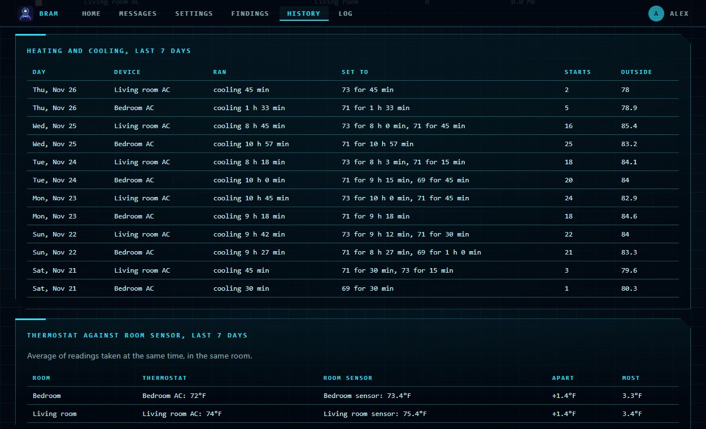

<p align="center">
  
</p>

<h1 align="center">BRAM</h1>
<p align="center"><b>Butler, Reconnaissance &amp; Automation Manager</b><br>
A self-hosted agent for your home that reaches out, instead of waiting to be asked.</p>

<p align="center">
<a href="https://github.com/imCharlieB/Bram/releases/latest"></a>
<a href="https://github.com/imCharlieB/Bram/actions/workflows/ci.yml"></a>
<a href="https://github.com/imCharlieB/Bram/blob/main/LICENSE"></a>
</p>


BRAM watches the devices you choose, tells your phone when something matters, remembers what happened, and talks with you using your own model. It runs on your network, and no cloud is required.

> **Early development.** BRAM watches, tells, and talks. **It cannot control anything yet**, and it does not replace certified smoke, CO, or security alarms.

[What it does](#what-it-does) · [Install](#install) · [Using it](#using-it) · [What to ask](#what-to-ask) · [Update](#update) · [Problems](#problems) · [Documentation](#documentation)

## What it does

| | |
|---|---|
| **Safety alerts** | Leak, smoke, CO, gas, and heat. Repeats until someone acknowledges. Runs in Home Assistant, so it works with the server or model down |
| **Silent sensors** | Tells you when a safety sensor stops reporting. Unknown is never treated as safe |
| **Locks and doors** | Unlocked at night, open while away, left open, offline |
| **Problems** | Failed integrations, repeating errors, low batteries, offline devices, stuck sensors, broken automations, old backups. Found without being asked |
| **3D printers** | Found by itself: progress, time left, temperatures. Told when finished, failed, paused, or a heater is left on |
| **Security check** | New admins and tokens, failed sign-ins, locks exposed to voice assistants, public webhooks, offline cameras, and more |
| **Findings** | One list of everything it found, with the story of each |
| **History and trends** | Temperatures, and every heating and cooling run with its settings. Compares each thermostat with the room's own sensor |
| **Chat** | On its page, in Assist, and in Telegram. Answers from live state, with the facts listed underneath |
| **Voice** | Hold to talk and spoken answers, with your own Whisper and Piper |
| **Personality** | Professional, friendly, dry, minimal, unhinged, or your own |
| **Learning** | Suggests better night hours. Nothing changes until you approve |
| **Outside Home Assistant** | Telegram or ntfy if Home Assistant, Ollama, Frigate, or another device goes down |

Everything that shares or stores more is off until you turn it on.

| Findings | History |
|---|---|
|  |  |

## What you need

| | |
|---|---|
| Home Assistant 2026.8 or later, with HACS | This integration |
| A 64-bit Intel or AMD machine with Docker | The **BRAM Server**. Best on a different machine, so each can report the other failing |
| The Home Assistant app on your phone | Home alerts |
| A chat model in [Ollama](https://ollama.com) | Optional. Only chat needs it; alerts never do |

## Install

BRAM has two halves. HACS installs only the integration; the server runs in Docker.

### 1. Start the server

**Portainer:** Stacks > Add stack > **Repository**

| Field | Value |
|---|---|
| Repository URL | `https://github.com/imCharlieB/Bram` |
| Reference | `refs/heads/main` |
| Compose path | `compose.yaml` |

**Or Docker Compose:**

```
git clone https://github.com/imCharlieB/Bram.git
cd Bram
docker compose up -d
```

### 2. Create your login

Open `https://SERVER:8765` right away, with **https**. The browser warns because the server makes its own certificate. Setup closes 15 minutes after the server starts; if it has closed, restart the container.

### 3. Add the integration

HACS > three dots > **Custom repositories** > add `https://github.com/imCharlieB/Bram` as an **Integration**. Download **BRAM** and restart Home Assistant.

### 4. Connect them

1. On BRAM's page: **Settings > Connect a Home Assistant > Get code**.
2. In Home Assistant: **Settings > Devices & services > Add integration > BRAM**. Enter the server's address, port `8765`, and the code.

### 5. Choose what it sees

**BRAM > Configure > Quick setup**: pick your phone, put anything you do not want to share under **Leave these out**, and submit. Nothing is shared until you do.

### 6. Check it

- BRAM's device page says **Connected**.
- Press **Send test message** there. It should reach your phone.
- For chat, on BRAM's page: **Settings > Model**, enter `http://HOST:11434`, **Find models**, **Save model**.

[Full instructions](https://github.com/imCharlieB/Bram/blob/main/docs/installation.md)

## Using it

### In Home Assistant: BRAM > Configure

| Page | Use it to |
|---|---|
| Quick setup | Turn on what most people want |
| Devices > Suggestions | Share important things it cannot see yet |
| Devices > Add by type and room | Share many at once, by type and area |
| Devices > Choose one by one | Add or remove one by one |
| Messages | Phones, quiet hours, daily summary |
| Watching | Home Assistant problems, 3D printers, lock and door rules, night hours, hourly security check |
| Server access | Let the server read history, problems, and the security check |
| Learning | Suggested hours, undo, delete |

### On BRAM's page: `https://SERVER:8765`

| Page | Use it to |
|---|---|
| Home | [What BRAM is doing](https://github.com/imCharlieB/Bram/blob/main/docs/home.md): watching, decisions, what needs you, and chat |
| Messages | Telegram, ntfy, and monitors |
| Settings | Homes, model, personality, voice |
| Findings | What it found, whether you were told, and how it ended |
| History | Turn history on, see trends, clean up |
| Log | Everything BRAM recorded |
| Profile | Password, second factor, signed-in devices |

### On your phone

| Message | Buttons |
|---|---|
| Safety alert | **Acknowledge**. It repeats until you do |
| Lock, door, or silent sensor | **Stop these**. Undo with **Allow stopped messages** on BRAM's device page |
| Several routine messages at once | Arrive as one |
| The same thing again and again | **Less often**, from the third time in a week |

Maintenance reminders reach your phone once a month at most. See [How often BRAM tells you](https://github.com/imCharlieB/Bram/blob/main/docs/how-often.md).

Quiet hours hold routine messages. Safety alerts, and locks and doors at night or while away, are never held.

### In Assist

**Settings > Voice assistants**: choose **BRAM Assist** as an assistant's conversation agent. BRAM itself cannot control anything; with **Prefer handling commands locally** on, Home Assistant still handles commands.

## What to ask

| Ask | Needs |
|---|---|
| "Is the back door locked?" "Who is home?" "What's on?" | The device shared |
| "When was the garage last opened?" | History on, under Server access |
| "Any errors in Home Assistant?" "Low batteries?" | Problems on |
| "How is the print going?" | 3D printers on |
| "Is my home secure?" | Security check on |
| "How long did the AC run each day?" "Is the bedroom thermostat reading right?" | Keep history on, on BRAM's History page |
| "Delete hall motion readings older than 90 days" | Keep history on. You confirm the list on the page |

## Privacy and safety

- It sees only the entities you choose. The server cannot call a Home Assistant service.
- The model has no tools. Alerts use fixed wording and no model.
- Models, speech, and history stay on your network. Home Assistant app messages use its push service, and Telegram is optional.
- Never forward BRAM's ports on your router.

[Security](https://github.com/imCharlieB/Bram/blob/main/docs/security.md) · [What BRAM stores](https://github.com/imCharlieB/Bram/blob/main/docs/data.md) · [Hard rules](https://github.com/imCharlieB/Bram/blob/main/HARD_RULES.md)

## Update

| Part | How |
|---|---|
| Integration | HACS > update BRAM > restart Home Assistant |
| Server | Portainer: recreate the bram container with **Re-pull image** on. Compose: `docker compose pull`, then `docker compose up -d` |

Update both; BRAM warns you when they differ. [Changes](https://github.com/imCharlieB/Bram/blob/main/CHANGELOG.md)

## Problems

| Problem | Try |
|---|---|
| Page does not load | Use `https` and port 8765; check the server's firewall |
| Setup is closed | Restart the container and reload |
| Configure pages are blank after an update | Refresh the browser with Ctrl+F5 |
| Not connected | Check the address, and that both halves are updated |
| No test message | Choose a phone in **Messages**; check the app's notification permission |
| An AC has no run times | It must report what it is doing, such as *cooling*, not only its mode |
| HACS shows no icon | Not something BRAM can fix; the icon shows in Home Assistant |
| Anything else | [Open an issue](https://github.com/imCharlieB/Bram/issues) with both version numbers. Remove addresses, tokens, and names first |

## Status

| Phase | |
|---|---|
| 1. One record: findings, history, cleaning up | Built |
| 2. Find: Home Assistant health, then 3D printers, climate, power, network | Home Assistant health and 3D printers built |
| 3. Explain: causes and what to do | Planned |
| 4. Control and fix: lights, one-tap repairs, then locks with approval | Planned |
| 5 to 10. Memory, cameras, learning, people, models, speakers | Planned |

[The whole plan](https://github.com/imCharlieB/Bram/blob/main/docs/roadmap.md)

## Documentation

**[All documentation](https://github.com/imCharlieB/Bram/blob/main/docs/README.md)**

| Start | Features | How it works |
|---|---|---|
| [Installing](https://github.com/imCharlieB/Bram/blob/main/docs/installation.md) | [Watching your home](https://github.com/imCharlieB/Bram/blob/main/docs/watching.md) | [Architecture](https://github.com/imCharlieB/Bram/blob/main/docs/architecture.md) |
| [Devices](https://github.com/imCharlieB/Bram/blob/main/docs/devices.md) | [Alerts and messages](https://github.com/imCharlieB/Bram/blob/main/docs/messages.md) | [Security](https://github.com/imCharlieB/Bram/blob/main/docs/security.md) |
| [Configuration](https://github.com/imCharlieB/Bram/blob/main/docs/configuration.md) | [Monitors](https://github.com/imCharlieB/Bram/blob/main/docs/monitors.md) | [What BRAM stores](https://github.com/imCharlieB/Bram/blob/main/docs/data.md) |
| [Every setting](https://github.com/imCharlieB/Bram/blob/main/docs/settings.md) | [Chat](https://github.com/imCharlieB/Bram/blob/main/docs/chat.md) | [Hard rules](https://github.com/imCharlieB/Bram/blob/main/HARD_RULES.md) |
| [Plan](https://github.com/imCharlieB/Bram/blob/main/docs/roadmap.md) | [Voice](https://github.com/imCharlieB/Bram/blob/main/docs/voice.md) | [Server commands](https://github.com/imCharlieB/Bram/blob/main/docs/server.md) |
| [Changes](https://github.com/imCharlieB/Bram/blob/main/CHANGELOG.md) | [How often BRAM tells you](https://github.com/imCharlieB/Bram/blob/main/docs/how-often.md) | |
| | [Personality](https://github.com/imCharlieB/Bram/blob/main/docs/personality.md) | [Development](https://github.com/imCharlieB/Bram/blob/main/docs/development.md) |
| | [Problems with Home Assistant](https://github.com/imCharlieB/Bram/blob/main/docs/problems.md) | |
| | [3D printers](https://github.com/imCharlieB/Bram/blob/main/docs/printers.md) | |
| | [Security check](https://github.com/imCharlieB/Bram/blob/main/docs/security-check.md) | [Testing your model](https://github.com/imCharlieB/Bram/blob/main/docs/benchmark.md) |
| | [Findings](https://github.com/imCharlieB/Bram/blob/main/docs/findings.md) | |
| | [History and trends](https://github.com/imCharlieB/Bram/blob/main/docs/history.md) | |
| | [Learning](https://github.com/imCharlieB/Bram/blob/main/docs/learning.md) | |

MIT licensed. See [LICENSE](https://github.com/imCharlieB/Bram/blob/main/LICENSE).
