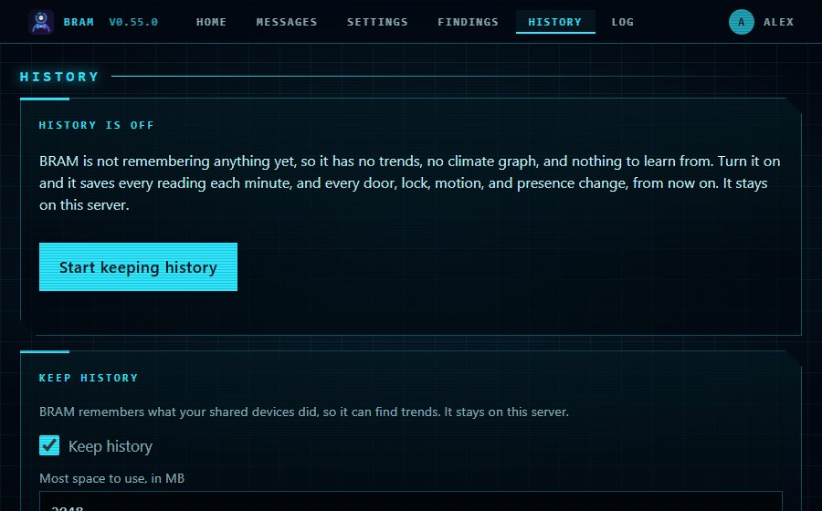
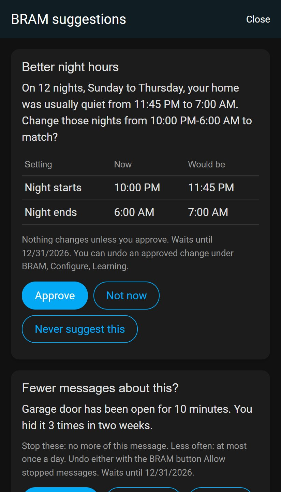

# Using BRAM day to day

You have installed both halves of BRAM: the integration in Home Assistant and the server in Docker. This page walks you through the first days, in the order most people need. Each part links to a page with the full detail. If you have not installed BRAM yet, start with [Installing](installation.md).

BRAM watches, tells, and talks. It cannot control anything, and it does not replace certified smoke, CO, or security alarms.

## 1. Pair and run Quick setup

1. On BRAM's page (`https://SERVER:8765`), go to **Settings > Connect a Home Assistant** and press **Get code**.
2. In Home Assistant, go to **Settings > Devices & services > Add integration > BRAM**. Enter the server's address, port `8765`, and the code. The code works once, for 10 minutes.
3. Open **BRAM > Configure > Quick setup**.
   - **Phones that get everything**: pick your phone.
   - The page lists the important things BRAM would share, such as people, locks, doors, and safety sensors. Put anything you do not want to share under **Leave these out**.
   - The switches below are on: unlocked at night, left open, offline, problems with Home Assistant, 3D printers (if any are found), history, and an 8 AM daily summary. Turn off what you do not want.
   - Press **Submit**. Nothing is shared until you do.
4. On BRAM's device page, check that **BRAM Server** says **Connected**, and press **Send test message**. It should reach your phone.

Quick setup is a starting point. You can change every part of it later, one page at a time.

Home Assistant's settings windows close when you save. Open **Configure** again for the next page.

## 2. Choose your devices

BRAM sees only what you share with it. **Configure > Devices** has four choices:

| Choice | Use it to |
|---|---|
| **Suggestions** | Add the important things BRAM cannot see yet, such as locks, doors, and safety sensors |
| **Add by type and room** | Add everything of a type, such as lights or motion, in the rooms you pick |
| **Choose one by one** | See everything you share, by group, and add or remove one at a time |
| **People's rooms** | Fix a person who shows the wrong room. Usually not needed |

Share everyone who lives in the home. BRAM decides the house is empty only when every person it can see is away, so a missing person makes "away" wrong.

To get the outside temperature on Home and in History, share a weather entity, such as `weather.home`. It is under **Thermostats, temperature, humidity, and weather**.

See [Devices](devices.md) for what each group covers.

## 3. Turn on what BRAM watches

Leak, smoke, CO, gas, and heat alerts are always on for the safety sensors you share. Everything else is off until you turn it on, under **Configure > Watching**:

| Page | What it watches |
|---|---|
| **Home Assistant and security** | Failed integrations, repeating errors, low batteries, offline devices, broken automations, old backups. Also the security check, every 10 minutes. See [Problems with Home Assistant](problems.md) and [Security check](security-check.md) |
| **Locks, doors, and windows** | Locks, doors, windows, garage doors, and motion. See below |
| **Temperature and humidity** | Too hot, too cold, near freezing, and humid, with your own limits in your home's unit. Leave out sensors that are outside, or meant to be hot or cold |
| **Cameras** | A person while everyone is away, at an open or unlocked door, or at night; a person Frigate does not know; packages; cars that stay in your driveway. See [Cameras](#cameras) below |
| **3D printers** | Prints finishing, failing, or pausing, and heaters left on. See [3D printers](printers.md) |

<!-- screenshot needed: the Configure > Watching menu in Home Assistant, with its five pages and Back -->

The locks and doors page, titled **Locks, doors, windows, and motion**, is in four groups:

| Group | Settings |
|---|---|
| **Locks** | **Unlocked at night**, and **A lock or door sensor goes offline** |
| **Doors and windows** | **Left open**, and how many minutes that means. Which kinds count: doors, windows, garage doors and gates. **Open at night**, and **Open while heating or cooling** |
| **While everyone is away** | **A lock unlocked, or a door or window open**, and **Motion**. Every door and window counts here. Pets can set off motion |
| **Night hours** | When night starts and ends, with separate Friday and Saturday hours if you want them. **Also night while any of these is on**: a helper you turn on at bedtime, such as `input_boolean.asleep`, makes it night while it is on |

Turn off **Count windows** if you sleep with windows open.

**3D printers start switched off.** Even with **Watch 3D printers** on, BRAM watches, shows, and mentions only the printers you switch on, one by one, on the same page.

See [How BRAM watches your home](watching.md) for every rule and how long each waits.

### Cameras

BRAM watches cameras through [Frigate](https://frigate.video). Only BRAM's server talks to Frigate, and it only reads.

1. On BRAM's page, **Settings > Cameras**: enter Frigate's address, such as `http://HOST:5000`, or its login port `https://HOST:8971` with a Frigate user that can only view. Select **Connect**.
2. Under **Which cameras BRAM watches**, turn on **Watch** for each camera. Their latest events show in **Looking at** on Home, and new ones open a window over the brain.
3. In Home Assistant, **Configure > Watching > Cameras > What to tell me**: turn on the messages you want.
4. **Configure > Watching > Cameras > Set up one camera**, for each camera that needs it: the doors and locks it looks at, which of Frigate's zones count, such as **driveway** or **porch**, and which messages it sends. Choose zones for a camera that sees the street or the neighbors, so passing people and cars are left out. Draw the zones in Frigate first; see [Your own driveway](cameras.md#your-own-driveway-not-the-neighbors).
5. Teach it: describe what each camera sees, and answer **Does it matter?** on camera windows and messages. See [Teach BRAM a camera](cameras.md#teach-bram-a-camera).

To have your own model describe what happened, turn on **Describe** for a camera under **Settings > Cameras**; see [Descriptions](cameras.md#descriptions-from-your-model). Then you can also ask it in chat, such as "Is anyone on the porch?", and add the [BRAM camera card](cameras.md#the-bram-camera-card) to a dashboard.

For a picture in each phone message, install the [Frigate integration](https://docs.frigate.video/integrations/home-assistant) in Home Assistant. Turn on snapshots in Frigate for a sharper one; without them, the message uses Frigate's thumbnail. See [Cameras](cameras.md) for every rule.

### Getting back

The **Devices** and **Watching** menus each end with **Back**. Choose it to return to BRAM's main settings.

## 4. Messages on your phone

**Configure > Messages** sets which phones get everything, which get safety alerts only, quiet hours, and the daily summary. Quiet hours hold routine messages. Safety alerts, and locks and doors at night or while everyone is away, are never held.

Some messages have buttons. To see them, expand the message: drag it down on Android, or press and hold it on iPhone.

| Button | Does |
|---|---|
| **Acknowledge** | Stops a safety alert repeating, for everyone. Only on the phone |
| **Stop these** | No more of this message from this device. Undo with **Allow stopped messages** on BRAM's device page |
| **Less often** | At most once a day. Offered from the third time in a week |

Tap the message itself to open it on BRAM's page, under **Findings**, with its story and the same buttons. Your phone must be able to reach the server at the address you used when pairing. The first time, its browser may warn about BRAM's own certificate.

See [Alerts and messages](messages.md) and [How often BRAM tells you](how-often.md).

<!-- screenshot needed: a BRAM phone message expanded to show Stop these and Less often -->

## 5. BRAM's Home page

Open `https://SERVER:8765`. Home shows what BRAM sees and what it is doing.

- **The brain** is in the middle, with your home's systems orbiting it: Home Assistant, people, security, safety, climate, lights, printers, messages, and learning. When something happens, that system flashes and a pulse runs into the brain.
- **Screens** run down both sides: Today, House, System, Watching, Climate, Needs you, What I did, and others. A screen with nothing to show stays hidden.
- **A closer look**: click a system on the orbit, or the House, System, 3D printers, Climate, or What I did screen. Its detail opens over the brain. **Escape** or **Close** puts it away.
- **Fold a screen**: click its tab to fold it down to just the tab, and again to open it. This browser remembers which are folded.

**Needs you** lists what wants your attention. Each finding there has buttons:

| Button | Does |
|---|---|
| **Story** | Opens that finding under Findings, with each step, including messages to your phone |
| **Stop these**, **Less often** | The same buttons your phone was given for that message, when it had them |
| **Hide** | Takes it off the list until it happens again; then it is back. It does not change what is sent to your phone. Hidden findings are under **Findings > Show > Hidden** |

Along the bottom are Findings, History, Messages, Mood, Settings, and Log, with the box to talk to BRAM in the middle.

See [BRAM's Home page](home.md) and [Findings](findings.md).

## 6. Keep history

BRAM's history is off until you turn it on. Go to **History** on BRAM's page and press the big **Start keeping history** button, then enter your password.

From then on, BRAM saves each reading every minute, and every door, lock, motion, and presence change. It stays on the server. Without it, BRAM has no trends, no climate graph on Home, and nothing to learn from. With it you can ask "How long did the AC run each day?" and see each print under **History > 3D prints**.

This is not the same as **History of shared devices** under **Configure > Server access**. That one lets BRAM read Home Assistant's own history, to answer questions such as when a door last opened and to bring in past temperatures.

See [History and trends](history.md).

## 7. Learning

Learning suggests better night hours and a better left-open time, from what your history shows. It needs **Keep history** on. Turn it on under **Configure > Learning > Learning is on**. The page shows how many of the 14 nights it needs have been found.

When BRAM has a suggestion, your phone gets a message. Tapping it opens BRAM's review page in the Home Assistant app, at `/bram-review`, with what BRAM noticed and each setting now and after. Only a Home Assistant administrator can open it or answer. Nothing changes until you approve.

See [Learning](learning.md).

## 8. Blueprints

BRAM's blueprints install themselves. Find them under **Settings > Automations & scenes > Blueprints**: **BRAM scheduled check** asks a yes-or-no question on a schedule and tells you only on yes, and **BRAM house summary** sends how the home is doing at a time you choose. They need **BRAM Assist** and a model on the server.

See [Blueprints](blueprints.md).

## 9. Chat and voice

- **On BRAM's page:** type in the box at the bottom of Home. First choose a model under **Settings > Model**. See [Chat](chat.md).
- **In Assist:** under **Settings > Voice assistants**, choose **BRAM Assist** as an assistant's conversation agent.
- **In Telegram:** set up Telegram on BRAM's **Messages** page and check **Let me chat with BRAM here**.
- **Voice:** under **Settings > Voice**, press **Set up voice**. Then hold **Hold to talk** on Home, and turn on **Speak answers** to hear the reply. See [Voice](voice.md).

Chat answers from what you shared. It lists the readings it used under each answer, so check important ones. It cannot control anything.

## 10. Updating

| Part | How |
|---|---|
| Integration | HACS: update **BRAM**, then restart Home Assistant |
| Server | Download the new `ghcr.io/imcharlieb/bram-server` image and recreate the container, however you run Docker. Docker Compose: `docker compose pull`, then `docker compose up -d`. Portainer: recreate the container with **Re-pull image** on. Unraid, Synology, and others: their own update or re-pull button |

Update both, and keep them on the same version. Each release in [Changes](../CHANGELOG.md) says which halves changed. When the versions differ, BRAM warns you on its page and in Home Assistant's Repairs. See [Installing](installation.md#updating).

After updating the integration, if a Configure page is blank, refresh the browser with Ctrl+F5.
