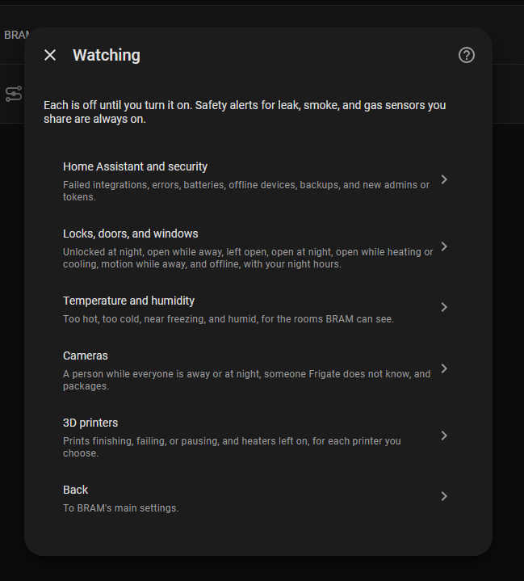
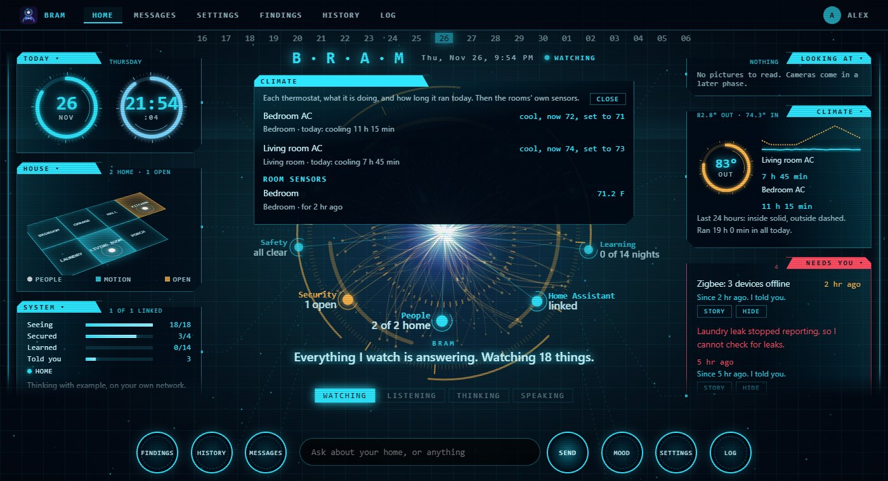

# Using BRAM

What you see and do with BRAM day to day.

On this page: [Using BRAM day to day](#using-bram-day-to-day) · [BRAM's Home page](#brams-home-page) · [Findings](#findings) · [History and trends](#history-and-trends)

## Using BRAM day to day

You have installed both halves of BRAM: the integration in Home Assistant and the server in Docker. This page walks you through the first days, in the order most people need. Each part links to a page with the full detail. If you have not installed BRAM yet, start with [Installing](installation.md#installing-1).

BRAM watches, tells, and talks. It cannot control anything, and it does not replace certified smoke, CO, or security alarms.

### 1. Pair and run Quick setup

1. On BRAM's page (`https://SERVER:8765`), go to **Settings > Connect a Home Assistant** and press **Get code**.
2. In Home Assistant, go to **Settings > Devices & services > Add integration > BRAM**. Enter the server's address, port `8765`, and the code. The code works once, for 10 minutes.
3. Open **BRAM > Configure > Quick setup**.
   - **Phones that get everything**: pick your phone.
   - The page lists the important things BRAM would share, such as people, locks, doors, and safety sensors. Put anything you do not want to share under **Leave these out**.
   - The switches below are on: unlocked at night, left open, offline, problems with Home Assistant, 3D printers (if any are found), history, and an 8 AM daily summary. Turn off what you do not want.
   - Press **Submit**. Nothing is shared until you do.
4. On BRAM's device page, check that **BRAM Server** says **Connected**, and press **Send test message**. It should reach your phone.

Quick setup is a starting point. You can change every part of it later, one page at a time.

Home Assistant's settings windows close when you save. Open **Configure** again for the next page.

### 2. Choose your devices

BRAM sees only what you share with it. **Configure > Devices** has four choices:

| Choice | Use it to |
|---|---|
| **Suggestions** | Add the important things BRAM cannot see yet, such as locks, doors, and safety sensors |
| **Add by type and room** | Add everything of a type, such as lights or motion, in the rooms you pick |
| **Choose one by one** | See everything you share, by group, and add or remove one at a time |
| **People's rooms** | Fix a person who shows the wrong room. Usually not needed |

Share everyone who lives in the home. BRAM decides the house is empty only when every person it can see is away, so a missing person makes "away" wrong.

To get the outside temperature on Home and in History, share a weather entity, such as `weather.home`. It is under **Thermostats, temperature, humidity, and weather**.

See [Devices](settings.md#devices) for what each group covers.

### 3. Turn on what BRAM watches

Leak, smoke, CO, gas, and heat alerts are always on for the safety sensors you share. Everything else is off until you turn it on, under **Configure > Watching**:

| Page | What it watches |
|---|---|
| **Home Assistant and security** | Failed integrations, repeating errors, low batteries, offline devices, broken automations, old backups. Also the security check, every 10 minutes, which tells you about new devices on your network. Home Assistant only sees its own network; to see every network and VLAN, [connect your router](watching.md#connect-your-router). See [Problems with Home Assistant](watching.md#problems-with-home-assistant) and [Security check](watching.md#security-check) |
| **Locks, doors, and windows** | Locks, doors, windows, garage doors, and motion. See below |
| **Temperature and humidity** | Too hot, too cold, near freezing, and humid, with your own limits in your home's unit. Leave out sensors that are outside, or meant to be hot or cold |
| **Cameras** | A person while everyone is away, at an open or unlocked door, or at night; a person Frigate does not know; packages; cars that stay in your driveway. See [Cameras](#cameras) below |
| **3D printers** | Prints finishing, failing, or pausing, and heaters left on. See [3D printers](watching.md#3d-printers) |

The locks and doors page, titled **Locks, doors, windows, and motion**, is in four groups:

| Group | Settings |
|---|---|
| **Locks** | **Unlocked at night**, and **A lock or door sensor goes offline** |
| **Doors and windows** | **Left open**, and how many minutes that means. Which kinds count: doors, windows, garage doors and gates. **Open at night**, and **Open while heating or cooling** |
| **While everyone is away** | **A lock unlocked, or a door or window open**, and **Motion**. Every door and window counts here. Pets can set off motion |
| **Night hours** | When night starts and ends, with separate Friday and Saturday hours if you want them. **Also night while any of these is on**: a helper you turn on at bedtime, such as `input_boolean.asleep`, makes it night while it is on |

Turn off **Count windows** if you sleep with windows open.

**3D printers start switched off.** Even with **Watch 3D printers** on, BRAM watches, shows, and mentions only the printers you switch on, one by one, on the same page.

See [How BRAM watches your home](watching.md#how-bram-watches-your-home) for every rule and how long each waits.

#### Cameras

BRAM watches cameras through [Frigate](https://frigate.video). Only BRAM's server talks to Frigate, and it only reads.

1. On BRAM's page, **Settings > Cameras**: enter Frigate's address, such as `http://HOST:5000`, or its login port `https://HOST:8971` with a Frigate user that can only view. Select **Connect**.
2. Under **Which cameras BRAM watches**, turn on **Watch** for each camera. Their latest events show in **Looking at** on Home, and new ones open a window over the brain.
3. In Home Assistant, **Configure > Watching > Cameras > What to tell me**: turn on the messages you want.
4. **Configure > Watching > Cameras > Set up one camera**, for each camera that needs it: the doors and locks it looks at, which of Frigate's zones count, such as **driveway** or **porch**, and which messages it sends. Choose zones for a camera that sees the street or the neighbors, so passing people and cars are left out. Draw the zones in Frigate first; see [Your own driveway](cameras.md#your-own-driveway-not-the-neighbors).
5. Teach it: describe what each camera sees, and answer **Does it matter?** on camera windows and messages. See [Teach BRAM a camera](cameras.md#teach-bram-a-camera).

To have your own model describe what happened, turn on **Describe** for a camera under **Settings > Cameras**; see [Descriptions](cameras.md#descriptions-from-your-model). Then you can also ask it in chat, such as "Is anyone on the porch?", and add the [BRAM camera card](cameras.md#the-bram-camera-card) to a dashboard.

For a picture in each phone message, install the [Frigate integration](https://docs.frigate.video/integrations/home-assistant) in Home Assistant. Turn on snapshots in Frigate for a sharper one; without them, the message uses Frigate's thumbnail. See [Cameras](cameras.md) for every rule.

#### Getting back

The **Devices** and **Watching** menus each end with **Back**. Choose it to return to BRAM's main settings.

### 4. Messages on your phone

**Configure > Messages** sets which phones get everything, which get safety alerts only, quiet hours, and the daily summary. Quiet hours hold routine messages. Safety alerts, and locks and doors at night or while everyone is away, are never held.

Some messages have buttons. To see them, expand the message: drag it down on Android, or press and hold it on iPhone.

| Button | Does |
|---|---|
| **Acknowledge** | Stops a safety alert repeating, for everyone. Only on the phone |
| **Stop these** | No more of this message from this device. Undo with **Allow stopped messages** on BRAM's device page |
| **Less often** | At most once a day. Offered from the third time in a week |

Tap the message itself to open it on BRAM's page, under **Findings**, with its story and the same buttons. Your phone must be able to reach the server at the address you used when pairing. The first time, its browser may warn about BRAM's own certificate.

See [Alerts and messages](watching.md#alerts-and-messages) and [How often BRAM tells you](watching.md#how-often-bram-tells-you).

<!-- screenshot needed: a BRAM phone message expanded to show Stop these and Less often -->

### 5. BRAM's Home page

Open `https://SERVER:8765`. Home shows what BRAM sees and what it is doing.

- **The brain** is in the middle, with your home's systems orbiting it: Home Assistant, people, security, safety, climate, lights, printers, messages, and learning. When something happens, that system flashes and a pulse runs into the brain.
- **Screens** run down both sides: Today, House, System, Watching, Climate, Needs you, What I did, and others. A screen with nothing to show stays hidden.
- **A closer look**: click a system on the orbit, or the House, System, 3D printers, Climate, or What I did screen. Its detail opens over the brain. **Escape** or **Close** puts it away.
- **Fold a screen**: click its tab to fold it down to just the tab, and again to open it. This browser remembers which are folded.

**Needs you** lists what wants your attention. Each finding there has buttons:

| Button | Does |
|---|---|
| **Story** | Opens that finding under Findings, with each step, including messages to your phone |
| **Stop these**, **Less often** | The same buttons your phone was given for that message, when it had them |
| **Hide** | Takes it off the list until it happens again; then it is back. It does not change what is sent to your phone. Hidden findings are under **Findings > Show > Hidden** |

Along the bottom are Findings, History, Messages, Mood, Settings, and Log, with the box to talk to BRAM in the middle.

See [BRAM's Home page](guide.md#brams-home-page) and [Findings](guide.md#findings).

### 6. Keep history

BRAM's history is off until you turn it on. Go to **History** on BRAM's page and press the big **Start keeping history** button, then enter your password.

From then on, BRAM saves each reading every minute, and every door, lock, motion, and presence change. It stays on the server. Without it, BRAM has no trends, no climate graph on Home, and nothing to learn from. With it you can ask "How long did the AC run each day?" and see each print under **History > 3D prints**.

This is not the same as **History of shared devices** under **Configure > Server access**. That one lets BRAM read Home Assistant's own history, to answer questions such as when a door last opened and to bring in past temperatures.

See [History and trends](guide.md#history-and-trends).

### 7. Learning

Learning suggests better night hours and a better left-open time, from what your history shows. It needs **Keep history** on. Turn it on under **Configure > Learning > Learning is on**. The page shows how many of the 14 nights it needs have been found.

When BRAM has a suggestion, your phone gets a message. Tapping it opens BRAM's review page in the Home Assistant app, at `/bram-review`, with what BRAM noticed and each setting now and after. Only a Home Assistant administrator can open it or answer. Nothing changes until you approve.

See [Learning](watching.md#learning).

### 8. Blueprints

BRAM's blueprints install themselves. Find them under **Settings > Automations & scenes > Blueprints**: **BRAM scheduled check** asks a yes-or-no question on a schedule and tells you only on yes, and **BRAM house summary** sends how the home is doing at a time you choose. They need **BRAM Assist** and a model on the server.

See [Blueprints](chat.md#blueprints).

### 9. Chat and voice

- **On BRAM's page:** type in the box at the bottom of Home. First choose a model under **Settings > Model**. See [Chat](chat.md#chat).
- **In Assist:** under **Settings > Voice assistants**, choose **BRAM Assist** as an assistant's conversation agent.
- **In Telegram:** set up Telegram on BRAM's **Messages** page and check **Let me chat with BRAM here**.
- **Voice:** under **Settings > Voice**, press **Set up voice**. Then hold **Hold to talk** on Home, and turn on **Speak answers** to hear the reply. See [Voice](chat.md#voice).

Chat answers from what you shared. It lists the readings it used under each answer, so check important ones. It cannot control anything.

To have BRAM remember things, such as who the neighbors are, turn on **Settings > Memory**, then say "Remember that...". See [Memory](chat.md#memory).

### 10. Updating

| Part | How |
|---|---|
| Integration | HACS: update **BRAM**, then restart Home Assistant |
| Server | Download the new `ghcr.io/imcharlieb/bram-server` image and recreate the container, however you run Docker. Docker Compose: `docker compose pull`, then `docker compose up -d`. Portainer: recreate the container with **Re-pull image** on. Unraid, Synology, and others: their own update or re-pull button |

Update both, and keep them on the same version. Each release in [Changes](../CHANGELOG.md) says which halves changed. When the versions differ, BRAM warns you on its page and in Home Assistant's Repairs. See [Installing](installation.md#updating).

After updating the integration, if a Configure page is blank, refresh the browser with Ctrl+F5.

## BRAM's Home page

Home is your look into what BRAM sees and what it is doing. It is not a dashboard of every device: Home Assistant has those.

In the middle is BRAM's brain, a knot of light threads. When something happens, it takes on that system's color for a few seconds: green for people, warm yellow for lights, amber for doors and locks, red for safety, sky blue for climate, violet for printers. Everything BRAM watches orbits it: Home Assistant, people, security, safety, climate, lights, printers, your monitors, your router, cameras, your model, messages, and learning, each with a short reading. One that is down turns red. When something happens in one of them, it flashes and a pulse runs into the brain. A card saying what happened, with its room on a tab (not for motion ending), appears in one of four places around the brain, stays a few seconds, and goes.

The version also shows next to BRAM's name at the top of every page. The title on Home shows what is running: the BRAM Server's version, and BRAM's in each connected Home Assistant. It turns amber when they differ in features, such as 0.40 and 0.41; update both. A fix on one side only, such as 0.40.3 and 0.40.4, is fine.

Along the bottom is the command bar: Findings, History, and Messages on the left, Mood, Settings, and Log on the right, and the chat box in the middle, with **Send**, and with [voice](chat.md#voice) set up, **Hold to talk** (the microphone) and **Speak answers** (the speaker) as icons inside it.

### Alerts over the brain

When something needs you, a window opens over the brain, like a screen in a command center: see-through, with cut corners, a glowing edge, and its label on a tab. The newest is open; older ones fold down to their title, and clicking a title opens that one:

| Window | When | Closes |
|---|---|---|
| Red | A safety alarm, a safety alert, a finding that matters most, or Home Assistant not connected | Only when you close it with **×**, or when it is over |
| Amber | Another alert or finding that needs you, or a person on a camera | After 30 seconds |
| Cyan | Another camera event, or a monitor answering again | After 15 seconds |

A camera window opens only for an event BRAM told your phone about, or held for quiet hours, under your [camera messages](cameras.md#what-it-tells-you). Every other event only updates **Looking at**, where tapping a camera opens its window. A camera window asks **Does it matter?**: see [Teach BRAM a camera](cameras.md#teach-bram-a-camera).

A finding's window has the same **Story**, **Stop these**, **Less often**, and **Hide** as under **Needs you**. A camera's window shows Frigate's picture. Windows open only for what is new while the page is open; what was already there is listed under **Needs you**. At most three are open at once. Cameras share one window: a new camera event replaces the last one, so several cameras at once never pile up.

While something needs you, rings keep going out from the brain: red and often for safety and the most important findings, amber now and then for the rest. While BRAM is thinking about a chat answer, arcs sweep around the brain.

Inside the brain a geodesic sphere turns, and around it rings of glowing dots ripple; when BRAM speaks they wave with its voice. When it answers you, its name forms in the middle from glowing dots and stays while it speaks, then drifts apart. Every few seconds a line draws out from the brain to one of your room readings, such as **LIVING ROOM 74°**. Moving between pages, the panels fold into a line and the new ones unfold one after another; with reduced motion set on your device, they simply appear.

Under the brain is what BRAM is saying, written out as it says it, and what it is doing now: **Watching**, **Listening**, **Thinking**, or **Speaking**. The ring around the brain moves with its voice. With [voice](chat.md#voice) on, the ring follows the real sound, both when BRAM speaks and while you hold to talk.

Screens down both sides each have a tab. Point at one, or tab into it, and it lights up.

| Screen | Shows |
|---|---|
| **Today** | The date and time |
| **House** | Your rooms, taken from Home Assistant's areas. A room lights up when someone moves there, turns amber when a door or window in it is open, and shows who is in it |
| **System** | How much BRAM can see, how much is shut and locked, nights learned, and messages sent today. Below that, each link to Home Assistant and your monitors, and why one is down |
| **Monitors** | Each of your [monitors](watching.md#monitors-1): up, down with why, or checking. **Manage** opens them. A monitor going down opens a red window; coming back, a cyan one |
| **3D printers** | Only while a print is running or paused: progress, time left, file, and nozzle, bed, and chamber temperatures against target. See [3D printers](watching.md#3d-printers) |
| **Watching** | What is counting down: a door left open with the minutes until you are told, a print until it finishes, and when night starts. Each says why |
| **Looking at** | With [cameras](cameras.md) connected, each camera's last event; tap one to open its picture in a window. Without them, how to connect Frigate |
| **Climate** | Outside temperature, from a weather entity you share with BRAM, such as Pirate Weather's, or else from temperature sensors in your yard or on your porch; the last 24 hours inside and outside; and how long each thermostat has run today. Needs [Keep history](guide.md#history-and-trends). Without a weather entity, it says to share one |
| **Needs you** | Safety alarms, open alerts, and open [findings](guide.md#findings) that matter, each with what to do. A finding has **Story**, which opens it under Findings; **Stop these** and **Less often** when your phone was given them (see [How often BRAM tells you](watching.md#how-often-bram-tells-you)); and **Hide**, which takes it off the list until it happens again but does not change what is sent to your phone. Hidden findings are under **Findings > Show > Hidden** |
| **I noticed** | Patterns: a room sensor that reads warmer or cooler than its thermostat over the week, how many nights are learned, and things not reporting |
| **What I did** | What BRAM told your phone, held back, or was told to stop today, and why something was held. See [How often BRAM tells you](watching.md#how-often-bram-tells-you) |

Screens with nothing to show stay hidden. When a side has more than fits, scroll it. Click a screen's tab to fold it down to just the tab, and again to open it; this browser remembers which are folded.

With history off, **Climate** has **Turn on history**, which goes to the History page.

### A closer look

Click a system on the orbit, or the House, System, 3D printers, Climate, or What I did screen, and its detail opens over the brain. It stays up to date while open. **Escape** or **Close** puts it away.

| Click | Shows |
|---|---|
| **People** | Each person and where they are |
| **Security** | Every lock, door, and window, open and unlocked first |
| **Safety** | Every leak, smoke, CO, gas, and heat sensor |
| **Climate** | Each thermostat: what it is doing, now and set temperatures, and how long it ran today; then the rooms' own sensors |
| **Lights** | Every light, those on first |
| **Printers** | Every printer, printing or not |
| **Home Assistant** | Whether it is linked, and anything shared that is not reporting |
| **Messages** | Everything told, held back, or stopped since yesterday, and why |
| **Learning** | How many nights are learned, and what happens at 14 |
| **House** | Each room, what is happening there, and everything in it |
| **System** | Everything BRAM depends on, and whether it answers |

Along the bottom: Findings, History, Messages, Mood, Settings, and Log, with the box to talk to BRAM in the middle. Its answers appear under the brain, with the readings they were based on.

The page refreshes every five seconds. With your system set to reduce motion, nothing moves. On a narrow screen the side screens stack under the brain. **Profile > Look** switches to the plain look.

## Findings

Everything BRAM found and what became of it, on BRAM's page under **Findings**.

| Comes from | Examples |
|---|---|
| Safety and silent sensors | Leak, smoke, a sensor that stopped reporting |
| Locks, doors, windows, and motion | Unlocked at night, left open, open at night, open while heating or cooling, open or motion while everyone is away, offline |
| Temperature and humidity | Too hot, too cold, near freezing, humid |
| [Learning](watching.md#learning) | A suggestion waiting, and how it was answered |
| [Problems](watching.md#problems-with-home-assistant), if turned on | Failed integrations, repeating errors, batteries, offline devices, automations, backups |
| [3D printers](watching.md#3d-printers), if turned on | Finished, failed, paused, heater left on |
| [Security check](watching.md#security-check), if its regular check is on | New token, new device on your network, failed sign-in, offline camera |
| [Monitors](watching.md#monitors-1) and connection | A monitor not answering, Home Assistant not answering |
| Messages | Daily summary |

Each finding is one line, however often it happens: first and last time, how many times, whether you were told, acknowledged, or stopped it, and when it was over. **Story** shows each step, including messages to your phones.

- **Hide** takes a finding off the list, and off Needs you on Home, until it happens again; then it is back. Hidden ones are under **Show > Hidden**, with **Show again**. Hide never stops a message to your phone; use **Stop these** for that. Hiding the same one again and again leads BRAM to suggest fewer messages about it; see [How often BRAM tells you](watching.md#suggestions-from-what-you-do).
- **Stop these** and **Less often** appear beside a finding whose phone message had them. See [How often BRAM tells you](watching.md#how-often-bram-tells-you).
- Home Assistant keeps up to 500 notes while the server is away and sends them when it is back. Alerts never wait for this.
- Something that ended while Home Assistant was off is closed as *No longer seen*, up to two hours after it starts.
- Locks and doors are recorded only if their rule is on, and wait the rule's time first.
- Chat knows what is open.
- Findings are kept until the home is removed. They are not history and do not need **Keep history**.

## History and trends

BRAM can remember what your shared devices did, in its own database. Off until you turn it on: while it is off, the History page on BRAM's page starts with **Start keeping history**. Press it and enter your password. **Keep history** below it turns it off again.

It records as things happen: each reading every minute, and each change when it happens. Nothing from before you turned it on is recorded, except the past readings below.

Without it, BRAM has no trends, no climate graph on Home, and nothing to learn from. [Learning](watching.md#learning) reads its quiet nights and door times from this history, so it needs **Keep history** on.

### What it keeps

| Kind | Detail |
|---|---|
| Readings | Every shared sensor with a number, thermostats' current temperature, and weather: sampled each minute, kept as low, average, and high for every 5 minutes and every hour |
| Heating and cooling | Each run: start, end, action, mode, preset, fan, what it was set to, inside and outside temperature. Changing the setting starts a new line |
| Changes | Doors, locks, motion, people, lights, and other on or off devices |

- A device that is unknown or disconnected is recorded as unknown, never as its last value.
- Outside temperature comes from a shared weather entity, from any weather integration, such as Pirate Weather or Met.no. Without one, temperature sensors outside count instead: those in an area or with a name that says yard, porch, patio, deck, garden, driveway, balcony, terrace, lawn, outside, or outdoor. Those outside sensors never count toward the inside average.
- Run times need a thermostat that reports what it is doing. Some report only their mode; BRAM cannot tell when those run.
- A run BRAM did not see all of is marked **not all seen**.

### Past readings

If **History of shared devices** is on in Home Assistant, under **BRAM > Configure > Server access**, BRAM brings in the hourly averages Home Assistant already keeps for those sensors. Heating and cooling runs have no past to bring in.

### Two sensors in one room

BRAM compares each thermostat's own sensor with other temperature sensors in the same Home Assistant area, at the same moments. Share both, and put both in the area.

### Ask

"How long did the AC run each day?" "Is the bedroom thermostat reading right?" Answers list the measured numbers below.

### Space

At 80% of the limit BRAM asks you what to remove, by Telegram or ntfy if set up, and in [Findings](guide.md#findings). At the limit, if you have not answered, the oldest 5-minute readings are removed; their hourly ones stay, and you are told. Nothing else goes without you.

### Clean up

**History > Clean up** lists every device with its size, biggest first. Choose devices, what to do, and how old, and press **Make the list**. BRAM shows exactly how many entries would go. Nothing changes until you press **Confirm** and enter your password, within 10 minutes.

| Choice | Does |
|---|---|
| Shorten to hourly | Removes 5-minute readings and keeps hourly ones |
| Delete | Removes readings, hours, changes, and runs |
| Stop keeping | Records nothing more for that device; keeps what is there |
| Keep again | Undoes Stop keeping |

Or ask in chat: "delete hall motion readings older than 90 days", "shorten attic readings older than a year", "stop keeping the garage sensor", "delete motion data before June". Chat only makes the list; you still confirm it on the page. If a device or date is unclear, no list is made. Sizes by device are close estimates.

The log, findings, and Home Assistant's own history are not touched.

### Turn off or delete

Turning it off stops recording and keeps what is there. **Delete all history** removes it. Removing a home deletes its history. Space already used is reused, and the file may not shrink.
