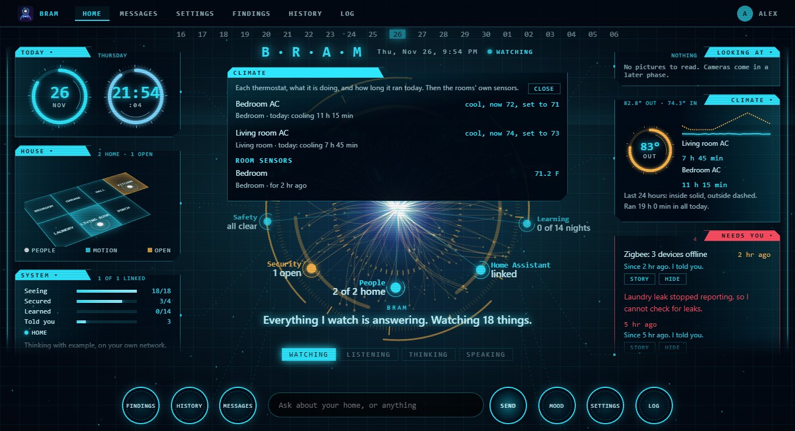

# BRAM's Home page

Home is your look into what BRAM sees and what it is doing. It is not a dashboard of every device: Home Assistant has those.

In the middle is BRAM's brain, a knot of light threads. Your home's systems orbit it: Home Assistant, people, security, safety, climate, lights, printers, messages, and learning, each with a short reading. When something happens in one of them, it flashes and a pulse runs into the brain. A card saying what happened appears near the brain, stays a few seconds, and goes.

## Alerts over the brain

When something needs you, a window opens over the brain, like a message on a command center's screen:

| Window | When | Closes |
|---|---|---|
| Red | A safety alarm, a safety alert, or a finding that matters most | Only when you close it with **×**, or when it is over |
| Amber | Another alert or finding that needs you, or a person on a camera | After 30 seconds |
| Cyan | A camera event, or a monitor answering again | After 15 seconds |

A finding's window has the same **Story**, **Stop these**, **Less often**, and **Hide** as under **Needs you**. A camera's window shows Frigate's picture. Windows open only for what is new while the page is open; what was already there is listed under **Needs you**. At most three are open at once.

While something needs you, rings keep going out from the brain: red and often for safety and the most important findings, amber now and then for the rest. While BRAM is thinking about a chat answer, arcs sweep around the brain.

Under the brain is what BRAM is saying, written out as it says it, and what it is doing now: **Watching**, **Listening**, **Thinking**, or **Speaking**. The ring around the brain moves with its voice. With [voice](voice.md) on, the ring follows the real sound, both when BRAM speaks and while you hold to talk.

Screens down both sides each have a tab. Point at one, or tab into it, and it lights up.

| Screen | Shows |
|---|---|
| **Today** | The date and time |
| **House** | Your rooms, taken from Home Assistant's areas. A room lights up when someone moves there, turns amber when a door or window in it is open, and shows who is in it |
| **System** | How much BRAM can see, how much is shut and locked, nights learned, and messages sent today. Below that, each link to Home Assistant and your monitors, and why one is down |
| **Monitors** | Each of your [monitors](monitors.md): up, down with why, or checking. **Manage** opens them. A monitor going down opens a red window; coming back, a cyan one |
| **3D printers** | Only while a print is running or paused: progress, time left, file, and nozzle, bed, and chamber temperatures against target. See [3D printers](printers.md) |
| **Watching** | What is counting down: a door left open with the minutes until you are told, a print until it finishes, and when night starts. Each says why |
| **Looking at** | With [cameras](cameras.md) connected, the latest picture from the cameras BRAM watches, and each camera's last event. Without them, how to connect Frigate |
| **Climate** | Outside temperature, from a weather entity you share with BRAM, such as Pirate Weather's, or else from temperature sensors in your yard or on your porch; the last 24 hours inside and outside; and how long each thermostat has run today. Needs [Keep history](history.md). Without a weather entity, it says to share one |
| **Needs you** | Safety alarms, open alerts, and open [findings](findings.md) that matter, each with what to do. A finding has **Story**, which opens it under Findings; **Stop these** and **Less often** when your phone was given them (see [How often BRAM tells you](how-often.md)); and **Hide**, which takes it off the list until it happens again but does not change what is sent to your phone. Hidden findings are under **Findings > Show > Hidden** |
| **I noticed** | Patterns: a room sensor that reads warmer or cooler than its thermostat over the week, how many nights are learned, and things not reporting |
| **What I did** | What BRAM told your phone, held back, or was told to stop today, and why something was held. See [How often BRAM tells you](how-often.md) |

Screens with nothing to show stay hidden. When a side has more than fits, scroll it. Click a screen's tab to fold it down to just the tab, and again to open it; this browser remembers which are folded.

With history off, **Climate** has **Turn on history**, which goes to the History page.

## A closer look

Click a system on the orbit, or the House, System, 3D printers, Climate, or What I did screen, and its detail opens over the brain. It stays up to date while open. **Escape** or **Close** puts it away.

| Click | Shows |
|---|---|
| **People** | Each person and where they are |
| **Security** | Every lock, door, and window, open and unlocked first |
| **Safety** | Every leak, smoke, CO, gas, and heat sensor |
| **Climate** | Each thermostat: what it is doing, now and set temperatures, and how long it ran today; then the rooms' own sensors |
| **Lights** | Every light, those on first |
| **Printers** | Every printer, printing or not |
| **Home Assistant** | Whether it is linked, and anything shared that is not reporting |
| **Messages** | Everything told, held back, or stopped since yesterday, and why |
| **Learning** | How many nights are learned, and what happens at 14 |
| **House** | Each room, what is happening there, and everything in it |
| **System** | Everything BRAM depends on, and whether it answers |

Along the bottom: Findings, History, Messages, Mood, Settings, and Log, with the box to talk to BRAM in the middle. Its answers appear under the brain, with the readings they were based on.

The page refreshes every five seconds. With your system set to reduce motion, nothing moves. On a narrow screen the side screens stack under the brain. **Profile > Look** switches to the plain look.
