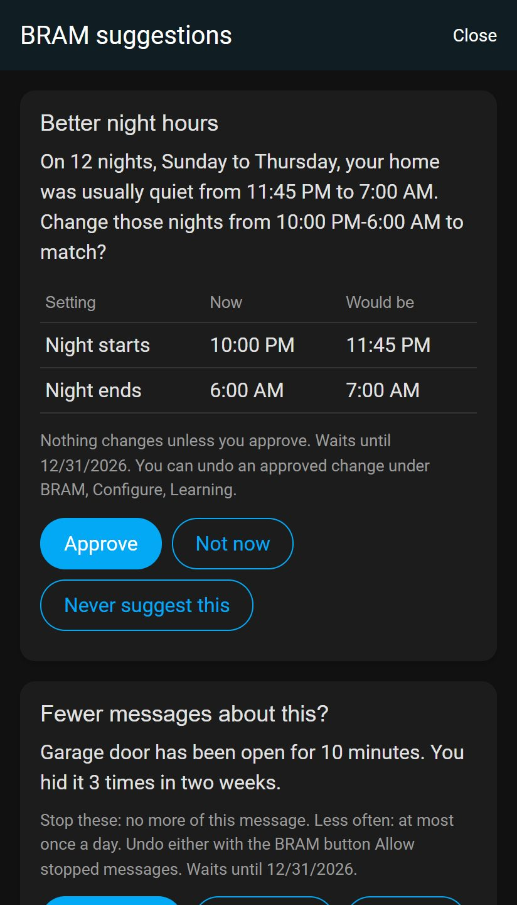

# Learning

BRAM can suggest better night hours and a better left-open time. Off by default, and it uses no model.

## Turn it on

**Settings > Devices & services > BRAM > Configure > Learning > Learning is on.** It needs motion sensors, doors, or locks that BRAM can see, and **Keep history** on BRAM's page (see [History](history.md)). The page shows how many nights it has found.

Learning reads BRAM's history, the one record of what happened in your home. It keeps no notes of its own. Nights recorded before you turned Learning on count too, so with two weeks of history the first suggestion can come the same day. Needs Home Assistant's BRAM and the server both on 0.34.0 or later.

## What it does

| Step | Detail |
|---|---|
| Reads | From history, each night from 6 PM to noon: the longest quiet stretch, 3 to 12 hours. Each day: how long doors stayed open. The last 60 days |
| Skips | Nights the server was not recording for at least nine tenths of, and nights with no clear quiet stretch |
| Waits | 14 nights, or 14 days and 20 openings |
| Suggests | Only a change of 30 minutes or more, or 10 minutes for left open, at most once every 30 days |

Sunday to Thursday and Friday to Saturday are worked out separately.

## Answer a suggestion

Your phones get one message, such as "Better night hours. Tap to review." Tapping it opens BRAM's review page in the Home Assistant app. It shows what BRAM noticed, how many nights support it, and a table of each setting now and what it would be.

The page is also at `/bram-review` on your Home Assistant address, such as `http://homeassistant.local:8123/bram-review`. It is not in the sidebar. Only a Home Assistant administrator can open it or answer, and the answer is recorded with their name under Findings.

| Choice | Result |
|---|---|
| Approve | The hours change |
| Not now | Ignored; another may come in 30 days |
| Never suggest this | That kind is never suggested again |

An unanswered suggestion goes away after 30 days. A suggestion can change only the hours and left-open time. It cannot turn a rule off or touch safety alerts.

## Other suggestions

The same review page also asks about fewer messages, when you keep hiding something or never act on it. See [How often BRAM tells you](how-often.md#suggestions-from-what-you-do).

## On BRAM's page

**History > Learning**, and **Learned** on Home, show how many nights history has and any suggestion waiting. Approving stays in Home Assistant, because a suggestion changes when lock and door alerts apply, and those settings never depend on the server.

If the server is down, your alerts and night hours keep working in Home Assistant. Those nights are not recorded, so a suggestion comes a little later.

## Nightly checks

BRAM also looks for doors, windows, garage doors, and locks you share that are often still open or unlocked late. From the last 28 nights of history, at 8 PM, 9 PM, 10 PM, 11 PM, midnight, and 1 AM, it counts the nights each was open or unlocked; unknown never counts. If it was on at least 8 nights, and at least 4 of every 10 nights it could see, it picks the **latest** of those hours, so a check does not nag while the door is still in use.

The review page then asks, for example: **Check Garage door at 11 PM?** "On 19 of the last 28 nights, Garage door was still open at 11 PM." Approve, and each night at 11 PM BRAM looks; if it is still open or unlocked, your phone gets "Garage door is still open. Your nightly check at 11 PM." It does not wait for quiet hours. Nothing is closed or locked for you; BRAM still controls nothing.

It skips anything one of your rules already covers, such as **Open at night** or **Unlocked at night** at that hour. **Never suggest this** stops it for that device. Remove an approved check by unchecking it under **Nightly checks you approved** on BRAM's **Learning** page in Home Assistant. Code finds every pattern; no model is involved.

## Undo or start over

On the same **Learning** page in Home Assistant:

| Choice | Does |
|---|---|
| Undo the last change I approved | Puts back the hours you had before |
| Erase what BRAM has learned and start over | Counts only nights from today on, and forgets any waiting suggestion and your Never answers. History itself is kept; delete it under **History > Clean up**. Your current hours stay |

Turning learning off stops suggestions. History keeps recording while **Keep history** is on.
