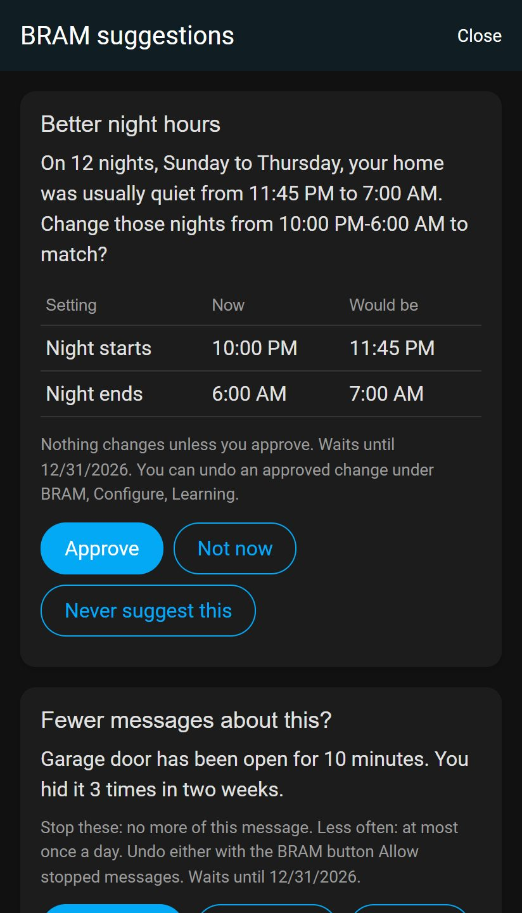

# What BRAM tells you

Everything BRAM watches, what it tells you, and how it learns.

On this page: [How BRAM watches your home](#how-bram-watches-your-home) · [Alerts and messages](#alerts-and-messages) · [How often BRAM tells you](#how-often-bram-tells-you) · [Problems with Home Assistant](#problems-with-home-assistant) · [3D printers](#3d-printers) · [Monitors](#monitors-1) · [Security check](#security-check) · [Learning](#learning)

## How BRAM watches your home

BRAM watches in Home Assistant itself, using plain rules. No model decides what is an alert, and it keeps working if the BRAM Server, the model, or the internet is down, though a phone must be reachable to get the message.

### From a change to a message

```
A device changes, or a timer runs
  → Is it a device you shared?
  → Does a rule you turned on apply?
  → Has it lasted long enough?
  → Told already, stopped, quiet hours, or daily limit?
  → Message to your phones, with buttons
  → Remembered until it is over, so it is news again next time
```

### The rules

| Rule | Looks at | Waits | Says | Default |
|---|---|---|---|---|
| Leak | Leak sensor on | 0 | Water leak detected | On for shared sensors |
| Smoke | Smoke sensor on | 0 | Smoke detected. Check now | On for shared sensors |
| Carbon monoxide, gas | Sensor on | 0 | Detected. Get out and call for help | On for shared sensors |
| Heat | Sensor on | 0 | Dangerous heat detected | On for shared sensors |
| Safety, tamper | Sensor on | 0 | Safety problem detected | On for shared sensors |
| Silent safety sensor | Any of those unreachable | 5 min | Stopped reporting | On for shared sensors |
| Unlocked at night | Lock unlocked or open in night hours | 2 min | Unlocked, and it's night | Off |
| Open or unlocked while away | Lock or door, and everyone shared known away | 2 min | Open, and everyone I track is away | Off |
| Left open | Door, window, or garage open; each type can be turned off | Your minutes | Open for that long | Off |
| Open at night | Door, window, or garage open in night hours; the types chosen under Left open | 2 min | Open, and it's night | Off |
| Open while heating or cooling | Door, window, or garage open while a shared thermostat is heating or cooling | Left open minutes | Open while the thermostat is cooling | Off |
| Motion while away | Motion, and everyone shared known away. Once per sensor until someone is home | 0 | Motion while everyone I track is away | Off |
| Too hot, too cold | Temperature sensors and thermostats' own reading, past your limits | 30 min | Above or below your limit | Off |
| Near freezing | Temperature below your near-freezing limit | 15 min | Near freezing. Pipes may freeze | Off |
| Humid | Humidity sensor above your limit | 30 min | Humid, above your limit | Off |
| Offline | Lock or door unreachable | 5 min | I can't see it | Off |
| Server lost | BRAM Server disconnected | 3 min | Not answering | On |

### Two kinds of message

| | Safety | Everything else |
|---|---|---|
| Repeats | Up to 11 times, until acknowledged | Once each time it happens |
| Quiet hours | Ignored | Respected, except unlocked at night, open at night, open or unlocked while away, motion while away, and near freezing |
| Can be stopped | No, only acknowledged | Yes, with **Stop these** |
| Daily limit | None | 10 for notices, 20 for lock and door rules |
| If sending fails | Tried again every minute | Tried again |
| Also shown inside Home Assistant | Yes | No |

A leak that dries out keeps reminding until someone acknowledges it. A lock that is locked again simply ends.

### Unknown is not safe

If a device is unavailable, BRAM does not assume it is locked, closed, or dry. If any shared person's location is unknown, BRAM does not decide the house is empty. If no people are shared, the away rule never runs.

### Night hours

You set when night starts and ends, separately from quiet hours. Night decides when an unlocked lock or an open door matters; quiet hours decide when routine messages wait.

Friday and Saturday nights can have their own hours. BRAM can [suggest better hours](watching.md#learning); nothing changes until you approve it.

If you have a helper or sensor that is on while someone is asleep, such as an `input_boolean` you turn on at bedtime, choose it under **Also night while any of these is on**. It is night while any of them is on, even before your hours start, as well as during your hours. If one is unavailable, only the hours count. This also covers a person at night on a [camera](cameras.md).

### What it does not do

It does not watch cameras, tell people apart, lock or close anything, or call anyone. It does not replace certified alarms.

### Turning it on

Safety alerts are on for every safety sensor you share. Everything else is off until you turn it on in **BRAM > Configure > Watching**:

| Page | Rules |
|---|---|
| **Locks, doors, and windows** | Unlocked at night, offline, left open, open at night, open while heating or cooling, while everyone is away, and night hours. See [Alerts and messages](watching.md#watching-locks-and-doors) |
| **Temperature and humidity** | Too hot, too cold, near freezing, and humid, with your limits in your home's unit, and sensors to leave out, such as outdoor ones |
| **Home Assistant and security** | [Problems with Home Assistant](watching.md#problems-with-home-assistant) and the hourly [security check](watching.md#security-check) |
| **3D printers** | [Printer messages](watching.md#3d-printers), for each printer you switch on |

Quick setup turns on unlocked at night, left open, and offline. Choose **Back** to return to the main settings. For a walkthrough, see [Using BRAM day to day](guide.md#using-bram-day-to-day).

## Alerts and messages

### Who tells you what

| Event | Sent by | Where |
|---|---|---|
| Leak, smoke, gas, carbon monoxide, heat, safety, or tamper: at once, then up to 11 reminders until acknowledged, even in quiet hours | Home Assistant | HA app, and inside Home Assistant |
| Safety sensor silent for 5 minutes | Home Assistant | HA app |
| Lock and door watching, if turned on | Home Assistant | HA app |
| BRAM Server lost for 3 minutes | Home Assistant | HA app |
| Home Assistant lost for 3 minutes: reminders until acknowledged or it returns | BRAM Server | Telegram, ntfy |
| A monitor not answering, or back | BRAM Server | Telegram, ntfy |

Home alerts do not need the server, a model, or the internet connection between them, but your phone still needs to be reachable. Only safety sensors you chose in BRAM's options are covered. Safety alerts use fixed wording; personality is not used in alerts.

Home Assistant and each of Telegram and ntfy send at most 10 routine messages a day. Safety alerts are not limited by that.

### Home Assistant app

1. Install the Home Assistant app on your phone and allow notifications.
2. **Settings > Devices & services > BRAM > Configure > Messages**. Choose your phones.
3. Set quiet hours if you want them. They apply only to Home Assistant's messages and never to safety alerts.
4. On BRAM's device page, press **Send test message**.

Safety alerts have **Acknowledge**. Lock, door, and silent-sensor messages have **Stop these**, and a message you get often also has **Less often**. To see the buttons, expand the message: drag it down on Android, or press and hold it on iPhone.

Tap a message to open it on BRAM's page, under Findings, with its story and buttons. The phone opens the address you entered when adding BRAM to Home Assistant, so it must be able to reach the server there. The first time, the phone's browser may warn about BRAM's own certificate. A grouped message, the daily summary, and the security check open Findings.

**Fallback (off by default):** with **Also use Telegram and ntfy if nobody answers a safety alert in 5 minutes** on, a safety alert nobody answers can also go to Telegram and ntfy. It needs the BRAM Server to be connected.

### Who gets what

| List | Gets |
|---|---|
| Phones that get everything | Safety alerts, lock and door messages, notices, daily summary |
| Phones that get safety alerts only | Leak, smoke, gas, carbon monoxide, heat, and other safety alerts |

Sharing a **person** with BRAM sends that person nothing. Anyone who gets a safety alert can acknowledge it for everyone. Telegram goes to the one linked account, and ntfy to whoever subscribes to its topic.

### Daily summary

In **Messages**, set **Daily summary at**. Once a day it lists what is open, not locked, or cannot be seen, who is home, and low batteries. It is sent at that time even in quiet hours, uses fixed wording, and needs no server. Leave it empty for none.

### Watching locks and doors

**BRAM > Configure > Watching > Locks, doors, and windows.** For problems with Home Assistant, see [Problems](watching.md#problems-with-home-assistant); for temperature and humidity, see [How BRAM watches your home](watching.md#how-bram-watches-your-home). The lock and door rules are off until you turn them on, and cover only the locks, doors, windows, garage doors, and motion sensors BRAM can see.

| Group | Choice | Tells you when | In quiet hours |
|---|---|---|---|
| Locks | Unlocked at night | A lock has been unlocked for 2 minutes during your night hours | Yes |
| | A lock or door sensor goes offline | It has been unreachable for 5 minutes | After they end |
| Doors and windows | Left open | It has been open longer than **Left open means this many minutes** | After they end |
| | Count doors, count windows, count garage doors and gates | Which kinds Left open and Open at night cover. All on | |
| | Open at night | One has been open for 2 minutes during your night hours | Yes |
| | Open while heating or cooling | One stays open past the left-open minutes while a thermostat is heating or cooling | After they end |
| While everyone is away | A lock unlocked, or a door or window open | It has been so for 2 minutes and everyone BRAM can see is away. Every door and window counts | Yes |
| | Motion | Motion while everyone is away, once per sensor until someone is home. Pets can set it off | Yes |
| Night hours | Night starts, night ends, and Friday and Saturday hours | | |

The **Watching** menu ends with **Back**, which returns to BRAM's main settings.

Two or more routine messages at once become one, without a button. A routine message waits 20 seconds first, so others that come up with it join it. Important ones never wait. Night and away messages that come due together become one for each rule, such as "Everyone I track is away, and these are open or unlocked: Bedroom window and Office window." They are never held back or mixed with routine ones.

#### How often

See [How often BRAM tells you](watching.md#how-often-bram-tells-you): urgent, each time, once until fixed, and reminders, with **Less often** when you want it.

You are told once each time, at most 20 times a day. **Stop these** stops one message for one device; undo it with **Allow stopped messages** on the device page.

**Away** counts only people BRAM can see. Add everyone who lives there, or it may call the house empty when it is not. If anyone's location is unknown, BRAM does not call the house empty.

### Telegram

Optional. Messages pass through Telegram's servers and are not end-to-end encrypted.

1. In Telegram, message **@BotFather**, send `/newbot`, and follow its questions. Copy the token and keep it private.
2. On BRAM's **Messages** page, paste the token, check **Turned on**, and **Save**.
3. Press **Link my account**, open the link, and press **Start** within 10 minutes.
4. Press **Send test**.

Only the linked account is answered. If the token leaks, use `/revoke` in @BotFather and save the new one. The token is stored in the server's data folder.

### ntfy

Optional, and not needed if you use Telegram. It runs beside BRAM and works at home or over a VPN; away from home it delivers when you reconnect. Traffic to it is not encrypted.

1. On BRAM's **Messages** page, check **Turned on**. Leave **Address BRAM uses** as `http://ntfy:80`. Set **Address your phone uses** to `http://SERVER:2586`. **Save**.
2. Install the free **ntfy** app (Play Store or F-Droid; no account needed) and allow notifications and instant delivery. If messages arrive late, set its battery use to Unrestricted.
3. Scan the QR code on BRAM's page, or open the page on your phone and tap the link. If neither opens ntfy, add a subscription in the app, choose another server, and enter the address and topic shown.
4. Press **Send test**.

Treat the topic like a password: anyone on your network who knows it can read your alerts. **New secret topic** replaces it. The server refuses everything except BRAM's randomly named topics. iPhones need extra ntfy setup for instant alerts.

### Monitors

See [Monitors](watching.md#monitors-1).

### What buttons and replies can do

Buttons can acknowledge, snooze, or stop a routine message. Safety alerts can only be acknowledged. Typed text is never a command, even in Telegram chat, and nothing here can approve or control anything. Undo **Stop these** from Telegram or ntfy on the **Messages** page. Undo **Stop these** from the HA app with **Allow stopped messages** on BRAM's device page.

### Try it

- Stop the BRAM container for 4 minutes. Home Assistant should tell you, and again when it is back.
- Stop Home Assistant for 4 minutes. Telegram and ntfy should tell you.

### Problems

| Problem | Try |
|---|---|
| No phone in the list | Sign in to the Home Assistant app, then reload BRAM's options |
| HA test message fails | Allow notifications for the app; choose a phone in BRAM's options |
| Telegram says it refused | Check the token, and that the server has internet access |
| Nothing after linking Telegram | Press **Start** in the chat; links last 10 minutes |
| ntfy test is Sent but nothing arrives | Check the phone can reach port 2586 and that the topic matches exactly |
| ntfy buttons do nothing | The phone must be able to reach **Address your phone uses** |
| A monitor is not answering but the thing is up | Check its type and the reason shown; remove it and add it again with the right type |
| ntfy suggests WebSockets | Optional; you can enable or dismiss it |
| Ntfy or monitor address refused | Only addresses on your own network are accepted |

## How often BRAM tells you

BRAM tells your phone about what matters, without repeating what you already know. These rules are in code, the same for every kind of message, and no model decides them.

### Four grades

| Grade | Phone | Examples |
|---|---|---|
| **Urgent** | Repeats until someone acknowledges | Leak, smoke, carbon monoxide, gas, heat |
| **Each time** | Every time it happens | Door left open, print finished or paused, unlocked at night, open while everyone is away |
| **Once until fixed** | Once. Again only if it comes back after being fixed for a whole day | Integration failed, device offline, printer heater left on, sensor stopped reporting |
| **Reminder** | Once a month at most. Always on BRAM's page | Lubricate, clean, replace a filter, firmware or update available, refill, due for service |

### How a message gets its grade

1. **What kind of thing it is.** Safety alerts are always urgent. A door left open, or a print finishing, happens each time. A failure or something offline is once until fixed.
2. **What the words say.** Words about looking after something, such as *lubricate*, *clean*, *replace*, *filter*, *firmware*, *update available*, *refill*, *due*, or *service*, make it a reminder, whatever sent it. This is how a printer's "Threaded rods need lubrication" is told once and then left on the page.
3. **What you chose.** Nothing becomes quieter on its own. You decide with the buttons below.

### Same thing, or something new

- The same words from the same device are the same thing. Different words are new and told at once, such as a printer that reports a new problem.
- A problem that goes away and comes back within a day is the same event, so a flickering warning is told once.
- Something that happens each time, like a door left open, is told each time. Its own rule already waits for it to last, so a door that is opened and closed is not news.

### Your buttons

| Button | Does | Undo |
|---|---|---|
| **Acknowledge** | Stops an urgent alert repeating | |
| **Stop these** | No more of this message from this device | **Allow stopped messages** on BRAM's device page |
| **It matters** / **Doesn't matter** | On camera messages: teaches your model what matters on that camera. It holds nothing back | **Forget** under **Settings > Cameras > What you taught BRAM** |
| **Less often** | At most once a day. Offered from the third time in a week | **Allow stopped messages** |

The phone shows the buttons when you expand the message: drag it down on Android, or press and hold it on iPhone.

**Stop these** and **Less often** also appear on BRAM's page, under **Needs you** on Home and beside the finding under **Findings**, for as long as the message is open. They are the same buttons the phone was given, and Home Assistant only accepts a button it offered for that message, once. **Acknowledge** is only on the phone, so nothing on BRAM's page or server can quiet a safety alert. Needs Home Assistant's BRAM and the server both on 0.33.0 or later.

BRAM never decides by itself that something told often is unimportant. A door left open every night may be exactly what you want to know.

### Suggestions from what you do

BRAM can ask instead. When, over two weeks, you **Hide** the same finding 3 times, or your phone is told about it 5 times and nothing is done (no button, no Hide), BRAM suggests fewer messages about it. Your phone gets one message, at most one a day, that opens the review page in the Home Assistant app. It shows the message and why, with **Stop these**, **Less often**, **Not now**, and **Never suggest this**. Nothing changes until an administrator answers there.

- Only routine messages: locks and doors, 3D printers, and Home Assistant problems. Never a safety alert or a silent safety sensor.
- Only the buttons your phone was really given for that message.
- Each is asked about at most once in 30 days, and never again after **Never suggest this**.
- Undo **Stop these** or **Less often** with **Allow stopped messages** on BRAM's device page.
- Needs Home Assistant's BRAM and the server both on 0.37.0 or later.

### Never held back

- Urgent alerts, which no quiet hours, limit, button, or grade can stop.
- Locks and doors unlocked or open at night or while everyone is away, motion while everyone is away, and near freezing: these ignore quiet hours, and **Less often** is not offered.

### Also limiting messages

- **Quiet hours** hold routine messages until they end.
- **Daily limits**: 10 notices, 20 lock and door messages, 8 problem messages, and 30 printer messages a day.
- **Grouping**: two or more routine messages at once arrive as one; each waits 20 seconds for others coming up with it. Urgent ones that come due together, such as several windows open when everyone leaves, arrive as one for each rule.

Everything held back is still in [Findings](guide.md#findings), with its story.

## Problems with Home Assistant

BRAM checks Home Assistant itself every 10 minutes, without being asked. Turn it on in **BRAM > Configure > Watching > Home Assistant and security** with **Watch Home Assistant for problems**, or in **Quick setup**. To ask chat about problems, also turn on **Home Assistant problems** under **Server access**. It reads only and fixes nothing yet.

| Finds | When |
|---|---|
| Integration failed to start, or keeps retrying | For 30 minutes |
| The same error repeating | 10 times within an hour |
| New repairs | As Home Assistant raises them |
| Low battery | Below 15%, until 20% |
| Phone battery | Below 20% at night and not charging |
| Device offline | Every part of it unavailable for 30 minutes |
| Whole integration offline | All of its devices, three or more |
| Stuck sensor | A temperature or humidity that has not changed in 2 days |
| Automation | Could not be loaded, or uses a device that does not exist |
| Backup | The last automatic one is more than 8 days old |
| Device reports trouble | Its own alert, error, alarm, or fault count is above 0, or its health reading is below 50% |
| Disk almost full, database over 10 GB | |
| Updates waiting | Listed in Findings only, no message |

### Messages

Each problem is told once, and again when it is fixed. Two or more at once are one message, and more than eight become a count, with the rest under [Findings](guide.md#findings). At most eight messages a day. Quiet hours hold them. **Stop these** stops one; undo it with **Allow stopped messages**. A problem that comes and goes is told once a day at most.

### Left out

- Phones, media players, and 3D printers being off or away. Printers have [their own rules](watching.md#3d-printers).
- Shared leak, smoke, lock, and door sensors, which have [their own rules](watching.md#how-bram-watches-your-home).
- Backups Home Assistant has never made, since they may be made another way.
- For two hours after Home Assistant starts, nothing is called fixed, because not every check has had time to look.

Error text has passwords, tokens, accounts, and addresses removed before it leaves Home Assistant. Removal cannot catch everything. What is found is sent to the BRAM Server for Findings.

## 3D printers

BRAM finds your printers by itself from the integration each one uses: Bambu Lab, Moonraker (Klipper), OctoPrint, PrusaLink, and others where they use the same names. Turn it on in **BRAM > Configure > Watching > 3D printers** with **Watch 3D printers**, or in **Quick setup**. The same **3D printers** page has a switch for each printer found. Only the printers you switch on there are watched, shown on Home, or mentioned; every printer starts off, even after Quick setup.

**BRAM only watches.** It cannot start, pause, stop, or heat anything. It is not a fire alarm.

### Shown on Home

The **3D printers** screen appears only while a print is running or paused: state, progress, time left, file, and the nozzle, bed, and chamber temperatures with their targets. Click it, or **Printers** on the orbit, to see every printer you switched on, printing or not. A printer whose integration is unreachable shows **Off**. A printer whose integration is failing is reported by [Problems with Home Assistant](watching.md#problems-with-home-assistant), if you turned it on.

### Messages

| Told when | After |
|---|---|
| Finished, failed, or stopped | At once |
| Paused | 1 minute |
| Reports a problem, such as a Bambu HMS error, with what it says | 1 minute |
| Stopped answering during a print | 5 minutes |
| Not printing, but a heater is still set and hot | 20 minutes |
| Printing, but the nozzle or bed is far below its target | 15 minutes |

- A maintenance reminder, such as lubricating the rods, is sent once a month at most and stays in Findings. A problem that comes and goes is told once, and again only after it has been fixed for a day. See [How often BRAM tells you](watching.md#how-often-bram-tells-you).
- Out of filament usually shows as paused or as a problem.
- Off while idle is normal and never a message. Cooling down after a print is not a heater left on.
- Quiet hours hold messages until they end. **Stop these** stops one kind for one printer; undo it with **Allow stopped messages**.
- Some printers do not say how a print ended. Then 99% or more counts as finished, and less as stopped.
- The same printer connected through two integrations appears twice. Turn one off in **BRAM > Configure > Watching > 3D printers**, or remove or disable it in Home Assistant.

### Remembered

With **Keep history** on, each print is kept: printer, file, result, length, and filament weight if the printer reports it. See **History > 3D prints**. A print BRAM did not see start has no length.

### Ask

"How is the print going?" "How long is left?" "What did I print this week?"

### Not yet

Pictures, spotting failed prints by camera, power used, and pausing with a tap are in the [plan](roadmap.md#3d-printers).

## Monitors

BRAM watches what it relies on without being asked: your model (Ollama), and Whisper and Piper once [voice](chat.md#voice) is set up. They are listed as watched automatically, follow your settings, and cannot be removed here. If you already watch the same machine (the same address, on any port), it is not doubled.

Monitors watch things outside Home Assistant, on your own network, and message you through Telegram or ntfy. Add them on BRAM's **Messages** page.

| Type | Address | Up when | Down when |
|---|---|---|---|
| Ollama | `http://HOST:11434` | It reports its version | Any error, or no answer |
| Frigate | `HOST:8971` or `HOST:5000` | It answers, or asks for a login | Server errors, or no answer |
| Computer or device | `HOST:PORT` | It accepts or refuses a connection | No answer |

- Checked when added, then every minute.
- You are told after three failures in a row, and again when it is back.
- The list shows the type and why it is not answering.
- Messages obey that channel's quiet hours and limit of 10 a day, and have **OK**, **Snooze 4 hours**, and **Stop these**.
- Only addresses on your own network are accepted. Nothing about your home is sent.
- Frigate's self-made certificate is accepted, because nothing private is sent to it.
- Up means it answered, not that everything in it works.

BRAM cannot report the failure of the machine it runs on. If Home Assistant runs elsewhere, it tells you that the BRAM Server is lost.

| Reason shown | Usually means |
|---|---|
| its certificate is not trusted | Wrong type; add Frigate as Frigate |
| could not connect | Off, or a wrong address or port |
| no reply in time | Blocked by a firewall, or asleep |
| it replied with error ... | Running, but not well |

## Security check

Looks at Home Assistant's own settings, and at what Home Assistant already knows about your network and radios. It reads only, changes nothing, and scans nothing. **A clean result does not mean your home is secure.**

### Turn it on

In **Settings > Devices & services > BRAM > Configure**:

| Where | Setting | Does |
|---|---|---|
| Server access | Security check | Lets you ask "Is my home secure?" |
| Watching > Home Assistant and security | Run the security check every 10 minutes | Checks every 10 minutes and messages your phones once about anything new |

Both are off by default. The check first learns what is already there, so only later changes are messages. Quiet hours hold everything except new accounts, new tokens, and an unencrypted outside address.

### What it checks

| Check | Reported when |
|---|---|
| New accounts and tokens | An administrator or long-lived token appears (the regular check only) |
| New device on your network | A device BRAM has not seen before gets a network address. Urgent if everyone BRAM can see is away (the regular check only). See below |
| New paired device | A new Zigbee, Z-Wave, Matter, Thread, or HomeKit device is paired, including Zigbee2MQTT (the regular check only) |
| Z-Wave locks | A Z-Wave lock was paired without S2 security; pair it again with S2 |
| Router | The router integration has a firmware update waiting, or its guest Wi-Fi switch is on |
| Apps | A Home Assistant app runs with protection mode off, or opens ports on the host |
| Administrators | More than two |
| Old tokens | Made more than 90 days ago. Home Assistant does not record whether they are used, so check before deleting |
| Failed sign-ins | Home Assistant is showing a failed sign-in notice |
| Sign-in bypass | Trusted networks skip the password |
| Voice assistants | A lock, alarm, garage, door, or gate is exposed to Assist, Alexa, or Google |
| Webhooks | An automation can be started from the internet |
| Offline devices | A lock, alarm, garage, door, gate, or camera has been offline for 30 minutes. Cameras on 3D printers are left out |
| Zigbee joining | A bridge's permit-join switch is on |
| Outside address | Uses plain http |
| UPnP | The UPnP integration is set up, which does not prove the router allows it |
| Updates | Home Assistant's own updates are waiting |

### Devices on your network

> **Home Assistant only sees its own network.** If you split your home into networks or VLANs, such as one for cameras and one for smart devices, Home Assistant cannot see devices on the others, or devices with a fixed address. To see every network, [connect your router](#connect-your-router) to BRAM.

BRAM uses every source it has, whatever router you use:

- **Your router, connected to BRAM**: every device on every network and VLAN, and the router's firmware. OPNsense for now.
- **Home Assistant's own network discovery**, which notices any device on Home Assistant's network that asks for an address. It is on in a normal Home Assistant.
- **A router integration's device list** in Home Assistant, if you have one with device tracking, such as UniFi, FRITZ!Box, eero, or Netgear.

The first look at each source learns every device already there, so connecting your router later does not make every device on it new. A device is known by its hardware address, whichever source reports it. After that, each new one is told once, with its name and network, or its address if it has no name. If everyone BRAM can see is away, it is urgent.

### Connect your router

BRAM reads your router; it never changes it.

**OPNsense**

1. In OPNsense, **System > Access > Users**: add a user for BRAM. Give it only these privileges: **Diagnostics: ARP Table**, **Status: DHCP leases**, and **System: Firmware**. Without the leases privilege it still works, but devices have no names.
2. On that user, under **API keys**, select **+** to create a key. OPNsense downloads a file with the key and secret.
3. On BRAM's page, **Settings > Router**: enter the router's address, such as `https://192.168.1.1`, the key, and the secret, and select **Connect**. Enter your BRAM password.

Use the address of OPNsense's web page, with its port if it is not 443, such as `https://192.168.1.1:8443`. If the router sends BRAM from one of its addresses to another, such as from http to https, BRAM follows it once and keeps the new one. You can paste the key and secret as they are in OPNsense's file, with or without `key=` and `secret=`.

If it does not connect, the message says why:

| Message | Try |
|---|---|
| Did not accept that API key and secret | Check them; make a new key if unsure |
| The key's user may not read this, or would not give its ARP table | Give BRAM's user the **Diagnostics: ARP Table** privilege, and **Status: DHCP leases** for names |
| Could not be reached | The address or port, and that the BRAM server may reach OPNsense's web page through your firewall |

BRAM trusts the router's certificate the first time and refuses to connect if it changes, so the key only goes to your router. It looks every 5 minutes. **Settings > Router** shows how many devices it sees, grouped by network, and whether a firmware update is waiting. **Disconnect** forgets the address and key. Only an address on your own network is accepted.

### What it does not check

Home Assistant Cloud remote access, passwords, and two-factor sign-in. If a check fails to run, or has nothing to look at, it is listed in the answer.

Account names and token ids never leave Home Assistant. Findings can name devices.

## Learning

BRAM can suggest better night hours and a better left-open time, [nightly checks](#nightly-checks) for what is often left open, and things to tell you about when they are [left on while everyone is away](#left-on-while-everyone-is-away). Off by default, and it uses no model.

### Turn it on

**Settings > Devices & services > BRAM > Configure > Learning > Learning is on.** It needs motion sensors, doors, or locks that BRAM can see, and **Keep history** on BRAM's page (see [History](guide.md#history-and-trends)). The page shows how many nights it has found.

Learning reads BRAM's history, the one record of what happened in your home. It keeps no notes of its own. Nights recorded before you turned Learning on count too, so with two weeks of history the first suggestion can come the same day. Needs Home Assistant's BRAM and the server both on 0.34.0 or later.

### What it does

| Step | Detail |
|---|---|
| Reads | From history, each night from 6 PM to noon: the longest quiet stretch, 3 to 12 hours. Each day: how long doors stayed open. The last 60 days |
| Skips | Nights the server was not recording for at least nine tenths of, and nights with no clear quiet stretch |
| Waits | 14 nights, or 14 days and 20 openings |
| Suggests | Only a change of 30 minutes or more, or 10 minutes for left open, at most once every 30 days |

Sunday to Thursday and Friday to Saturday are worked out separately.

### Answer a suggestion

Your phones get one message, such as "Better night hours. Tap to review." Tapping it opens BRAM's review page in the Home Assistant app. It shows what BRAM noticed, how many nights support it, and a table of each setting now and what it would be.



The page is also at `/bram-review` on your Home Assistant address, such as `http://homeassistant.local:8123/bram-review`. It is not in the sidebar. Only a Home Assistant administrator can open it or answer, and the answer is recorded with their name under Findings.

| Choice | Result |
|---|---|
| Approve | The hours change |
| Not now | Ignored; another may come in 30 days |
| Never suggest this | That kind is never suggested again |

An unanswered suggestion goes away after 30 days. A suggestion can change only the hours and left-open time. It cannot turn a rule off or touch safety alerts.

### Other suggestions

The same review page also asks about fewer messages, when you keep hiding something or never act on it. See [How often BRAM tells you](watching.md#suggestions-from-what-you-do).

### On BRAM's page

**History > Learning**, and **Learned** on Home, show how many nights history has and any suggestion waiting. Approving stays in Home Assistant, because a suggestion changes when lock and door alerts apply, and those settings never depend on the server.

If the server is down, your alerts and night hours keep working in Home Assistant. Those nights are not recorded, so a suggestion comes a little later.

### Nightly checks

BRAM also looks for doors, windows, garage doors, and locks you share that are often still open or unlocked late. From the last 28 nights of history, at 8 PM, 9 PM, 10 PM, 11 PM, midnight, and 1 AM, it counts the nights each was open or unlocked; unknown never counts. If it was on at least 8 nights, and at least 4 of every 10 nights it could see, it picks the **latest** of those hours, so a check does not nag while the door is still in use.

The review page then asks, for example: **Check Garage door at 11 PM?** "On 19 of the last 28 nights, Garage door was still open at 11 PM." Approve, and each night at 11 PM BRAM looks; if it is still open or unlocked, your phone gets "Garage door is still open. Your nightly check at 11 PM." It does not wait for quiet hours. Nothing is closed or locked for you; BRAM still controls nothing.

It skips anything one of your rules already covers, such as **Open at night** or **Unlocked at night** at that hour. **Never suggest this** stops it for that device. Remove an approved check by unchecking it under **Nightly checks you approved** on BRAM's **Learning** page in Home Assistant. Code finds every pattern; no model is involved.

### Left on while everyone is away

BRAM also looks at the lights, switches, and fans you share. From the last 28 days of history, every 15 minutes while everyone you share was known to be away, it notes which were on for ten minutes or more. One that was on like that on at least 5 days is suggested on the review page: **Tell you when Kitchen light is left on while everyone is away?**

Approve, and when everyone is away and it has been on for ten minutes, your phone gets "Kitchen light is on, and everyone I track is away." Several at once are one message. BRAM never turns anything off. Remove it under **Told when left on while everyone is away** on BRAM's **Learning** page in Home Assistant.

### Undo or start over

On the same **Learning** page in Home Assistant:

| Choice | Does |
|---|---|
| Undo the last change I approved | Puts back the hours you had before |
| Erase what BRAM has learned and start over | Counts only nights from today on, and forgets any waiting suggestion and your Never answers. History itself is kept; delete it under **History > Clean up**. Your current hours stay |

Turning learning off stops suggestions. History keeps recording while **Keep history** is on.
